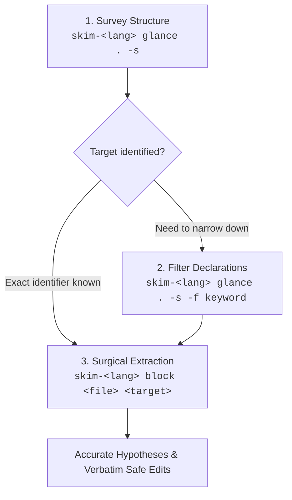

# Developmental Helper Toolkit 

This repository is a collection of tools that helped with development, especially in the age of agentic coding, which includes:
- [`skim-*`](#skim-): Language-specific, AST-resilient outlines and verbatim code extractors tailored for AI coding agents.
- [Transcript Viewer](#transcript-viewer): Coding agent exported transcript viewer.

# `skim-*`

[](Design.md)
[](LICENSE)


A unified suite of lightweight, high-performance developer tools conforming to the [`skim-*` Family Design Specification](Design.md).

---

## The Problem: The Agent Context Tax

When AI coding assistants (such as Claude, Gemini, ChatGPT, or Cursor) operate on real-world codebases, standard code ingestion techniques degrade agent performance, burn token budgets, and cause context drift:

1. **Context Exhaustion & Attention Dilution**: Dumping 1,000–5,000 line source files burns through context windows rapidly. Irrelevant implementation details dilute model attention, leading to missed context and hallucinations.
2. **The "Grep & Snippet" Partial Context Trap**: Line-based search tools (`grep`, `rg -C 5`) only capture arbitrary line windows. They truncate function signatures, miss enclosing scopes, cut off closing braces, or drop docstrings. The agent is forced to guess surrounding context or issue secondary read requests.
3. **The Test Bloat Trap**: In modern codebases, test files (`*_test.go`, `tests/`, `*.test.ts`) and test suites comprise 50–75% of total lines. When surveying domain architecture, ingesting test suites introduces massive prompt noise.
4. **The Infinite Read Loop**: Agents read file A, discover a method on type B in file B, read all of file B, and repeat—quickly exhausting tool calls and token budgets.
5. **Syntax Sensitivity During In-Flight Edits**: Codebases undergoing refactoring or active edits often have temporary syntax errors. Traditional strict parsers abort, leaving agents blind to surrounding valid declarations.

---

## The Solution: Two Surgical Tools

`skim-*` tools provide agents (and developers) a consistent, two-command mental model across all supported languages:

- **`glance`**: High-density AST outlines displaying declarations, signatures, type definitions, and line spans—with test suites, test files, and implementation bodies filtered out by default.
- **`block`**: Complete, AST-bounded verbatim code extraction for an exact function, struct, interface, or qualified member (`Type.Method` / `Type::method`). Delivers complete syntactic context (docstrings, signatures, and full body) without truncation or irrelevant file contents.



---

## Supported Languages & Tools

| Language | Binary | Package & Registry | AST Engine | Directory |
|---|---|---|---|---|
| **Go** | `skim-go` | [](https://pkg.go.dev/github.com/benedictjohannes/programming-helper-utils/go/skim-go) | `go/parser` (stdlib, zero deps) | [`go/skim-go`](go/skim-go/) |
| **Rust** | `skim-rs` | [](https://crates.io/crates/skim-rs) | `ra_ap_syntax` (Rust Analyzer) | [`rust/skim-rs`](rust/skim-rs/) |
| **TypeScript / JS** | `skim-ts` | [](https://www.npmjs.com/package/skim-ts) | TypeScript Compiler API | [`typescript/skim-ts`](typescript/skim-ts/) |
| **Python** | `skim-py` | [](https://pypi.org/project/skim-python/) | `ast` (stdlib, zero deps) | [`python/skim-py`](python/skim-py/) |

All tools adhere to the common standard defined in [Design.md](Design.md).

---

## Universal CLI Interface

Every `skim-*` tool implements an identical CLI interface:

```text
skim-<lang> glance [options] <path>...
skim-<lang> block  [options] <file> <target>
```

### Common `glance` Options

- `-s, --signatures`: Show declarations & types (omits function and method bodies).
- `-d, --details`: Expand struct fields, interface members, enum variants, and class properties.
- `-u, --uses, --imports`: Display top-level imports and uses.
- `-f, --filter <text>`: Case-insensitive keyword filter (repeatable for AND filtering).
- `-t, --include-tests`: Include test files and test suites (omitted by default).

### Common `block` Options

- `--raw`: Print without line-number gutters (ready for clean clipboard copy or LLM tool edit targeting).
- `-t, --include-tests`: Include test files and test blocks during target lookups.

---

## Installation Quick Start

### Go (`skim-go`)

Requires Go 1.22+:

```bash
go install github.com/benedictjohannes/programming-helper-utils/go/skim-go@latest
```

### Rust (`skim-rs`)

From [crates.io](https://crates.io/crates/skim-rs) (or build from source with Rust 1.85+):

```bash
cargo install skim-rs
```

### TypeScript / JavaScript (`skim-ts`)

Run on-demand or install globally via Bun / NPM:

```bash
# On-demand
bunx skim-ts glance src/ -s
npx skim-ts block src/index.ts MyClass.run

# Global install
bun add -g skim-ts
# or: npm install -g skim-ts
```

### Python (`skim-py`)

Run on-demand or install globally via `uv` or `pipx`:

```bash
# On-demand
uvx --from skim-python skim-py glance src/ -s
pipx run --spec skim-python skim-py block src/main.py App.run

# Global install
uv tool install skim-python
# or: pipx install skim-python
```

---

## Quick Setup: Let Your Agent Configure Itself

Instead of manually editing config files, copy and paste this single prompt directly into your AI coding assistant (Cursor, Claude Code, Windsurf, Antigravity, etc.):

```text
Ask me which languages in this project or my environment need AST skimming support (Go, Rust, and/or TypeScript/JavaScript).
Then, check if the corresponding `skim-*` tool(s) are installed in PATH, and install any missing ones:
- Go (`skim-go`): `go install github.com/benedictjohannes/programming-helper-utils/go/skim-go@latest`
- Rust (`skim-rs`): `cargo install skim-rs`
- TypeScript/JavaScript (`skim-ts`): `bun add -g skim-ts` (or `npm install -g skim-ts`)

After verifying or installing, run `skim-<lang> --help` to inspect their usage and `Agent Operational Workflow`.
Finally, ask whether to configure this globally or repo-specifically, and update your coding harness or system instructions accordingly so that you always prioritize `skim-<lang> glance -s` and `skim-<lang> block` over reading entire files or blind grep snippets.
```

---

## Repository Documentation

- [Design.md](Design.md): Formal architecture and behavior specification across all implementations.
- [Go implementation (`skim-go`)](go/skim-go/README.md)
- [Rust implementation (`skim-rs`)](rust/skim-rs/README.md)
- [TypeScript implementation (`skim-ts`)](typescript/skim-ts/README.md)

---

# Transcript Viewer

[](Design.TranscriptViewer.md)

A local-only, compile-to-single-HTML web application designed to visualize, inspect, and navigate conversation transcripts produced by coding agents and LLMs. 

- **Privacy First**: Everything runs client-side in the browser—nothing leaves your computer.
- **Multi-Platform Support**: Tested on **Antigravity** and **OpenCode**; experimental support for **Claude Code** and **Standard Chat / OpenAI**.
- **Deep Collapsibility**: Full turns, XML tag bubbles (`<USER_REQUEST>`, `<ADDITIONAL_METADATA>`, etc.), and individual tool calls can be expanded or collapsed recursively.
- **Rich Visualizations**: Side-by-side file edit diffs, command-line blocks, token usage statistics, and model thinking/reasoning blocks.
- **In-Memory Search**: Full-text search with match cycling (`Enter` / `Shift+Enter`) and scope filters.
- **Single HTML Distribution**: Compiles via Bun + Vite into a standalone `dist/index.html` with zero external runtime dependencies.

See [`transcriptViewer/README.md`](transcriptViewer/README.md) for build instructions and [`Design.TranscriptViewer.md`](Design.TranscriptViewer.md) for architectural details.

# License

MIT © Benedict Johannes
