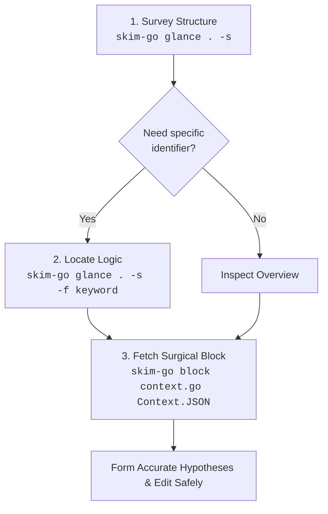

# `skim-go`

[](https://pkg.go.dev/github.com/benedictjohannes/programming-helper-utils/go/skim-go)
[](../../LICENSE)

A fast, zero-dependency, AST-based Go outline and verbatim code block extractor tailored for AI coding agents and terminal workflows.

> Part of the [`skim-*` family - check out the complete suite](https://github.com/benedictjohannes/programming-helper-utils). Conforms to the [`skim-*` Family Design Specification](https://github.com/benedictjohannes/programming-helper-utils/blob/master/Design.Skim.md).

---

## Why `skim-go`?

When AI coding assistants (like Claude, Gemini, ChatGPT, or Cursor) operate on real-world codebases, feeding entire source files into prompt context is one of the quickest ways to degrade agent performance:

1. **Context Window Exhaustion & Attention Drift**: Dumping 1,000–3,000 line source files burns through token budget rapidly. More critically, irrelevant implementation details dilute the model's attention, leading to hallucinations and missed context.
2. **The Go Test Bloat Trap**: In Go repositories, unit test files (`*_test.go`) and table-driven suites often constitute 60–75% of the codebase volume. For instance, in `gin-gonic/gin`, `context_test.go` is over 120KB (~3,500 lines) while the actual `context.go` logic is only 48KB. Ingestion of test files during architectural or logic exploration adds massive noise.
3. **Repeated File Reading Loops**: Agents often read file A, find a call to a method on struct B in file B, read all of file B, and repeat—quickly exhausting tool call limits and token budgets.
4. **Syntax Tolerance During Edits**: Codebases being actively refactored or edited often have syntax errors. Traditional strict tools fail completely, leaving the agent unable to inspect surrounding structures.

`skim-go` solves this by giving agents (and developers) a pair of surgical tools:
- **`glance`**: Instant, high-density outlines of declarations, signatures, struct fields, and line spans—with `*_test.go` files, `Test*` functions, and function bodies filtered out by default.
- **`block`**: Verbatim code retrieval for an exact struct, function, interface, or qualified receiver method (`Type.Method` / `Context.JSON`) with line gutters or raw code ready for editing.

---

## Recommended Agent Workflow



1. **Survey (`glance -s`)**: Get the structural topography of a package or file in under 100 tokens.
2. **Locate (`glance -f <keyword>`)**: Narrow down matching declarations across files with case-insensitive substring filters.
3. **Inspect (`block <file> <target>`)**: Fetch the exact verbatim implementation block with accurate file line numbers for precision editing.

---

## Features

- **Go Standard Library AST (`go/parser`, `go/ast`, `go/printer`)**: Zero third-party dependencies. Parses modern Go 1.22+ syntax, generics, methods, and complex struct tags with native accuracy.
- **Error-Resilient Parsing & Syntax Diagnostics**: Parses incomplete or syntactically invalid code gracefully during active edits. Emits syntax notices directly without crashing or omitting valid surrounding declarations.
- **Test-Blind by Default**:
  - Automatically excludes `*_test.go` files during directory and pattern traversals unless `-t` / `--include-tests` is specified.
  - Automatically filters out `func Test*`, `func Benchmark*`, `func Example*`, and `func Fuzz*` inside single files unless `-t` is passed.
- **Receiver-Transparent `Type.Method` Matching**:
  - Matches methods regardless of whether they use pointer receivers `func (c *Context) JSON(...)` or value receivers `func (c HandlersChain) Last(...)` via the canonical `Type.Method` syntax.
  - Tolerates inputs like `(*Context).JSON` or `*Context.JSON`.
- **Exact-Case Precedence with Case-Insensitive Fallback**: Tolerates casing mismatches (`context.json`), while prioritizing exact matches if both `type Config` and `var config` coexist.
- **Clear Ambiguity Diagnostics**: If a generic target matches multiple candidates, `skim-go` exits with code `3` and lists candidate locations with line spans and disambiguation guidance.
- **Blazing Fast**: Native compiled static binary with near-instant execution (<10ms).

---

## Installation

### Via `go install` (Recommended)

Requires Go 1.22+:

```bash
go install github.com/benedictjohannes/programming-helper-utils/go/skim-go@latest
```

This installs `skim-go` into `$GOPATH/bin` (or `~/go/bin`). Ensure that directory is in your `PATH`.

### From Source

```bash
git clone https://github.com/benedictjohannes/programming-helper-utils.git
cd programming-helper-utils/go/skim-go
go build -o skim-go .

# Move to a directory in your PATH (e.g. ~/.local/bin or /usr/local/bin)
mv skim-go ~/.local/bin/
```

---

## CLI Reference & Concrete Examples

> [!NOTE]
> All examples below are authentic, unedited outputs produced by running `skim-go` against the real-world [`gin-gonic/gin`](https://github.com/gin-gonic/gin) repository.

```text
Usage:
  skim-go glance [options] <path>...
  skim-go block  [options] <file> <target>
```

---

### 1. `glance` Subcommand

Outlines structure, signatures, struct fields, and imports across files or directories.

```text
Usage:
  skim-go glance [options] <path>...

Arguments:
  <path>...                 One or more .go files, directories, or globs

Options:
  -s, --signatures          Show declarations & types without function bodies
  -d, --details             Show struct fields and interface members
  -u, --uses, --imports     Display top-level imports
  -f, --filter <text>       Filter items containing <text> (case-insensitive, repeatable)
  -t, --include-tests       Include test files (*_test.go) and test functions
```

#### Example 1: Basic Structural Outline of a File

```bash
skim-go glance gin.go
```
```text
=== gin.go (861 lines) ===

Outline:
  L27-L27      const defaultMultipartMemory
  L28-L28      const escapedColon
  L29-L29      const colon
  L30-L30      const backslash
  L37-L37      const defaultReadHeaderTimeout
  L40-L40      var default404Body
  L41-L41      var default405Body
  L44-L44      var defaultPlatform
  L46-L55      var defaultTrustedCIDRs
  L58-L58      type HandlerFunc
  L61-L61      type OptionFunc
  L64-L64      type HandlersChain
  L67-L72      func (c HandlersChain) Last
  L75-L80      type RouteInfo
  L83-L83      type RoutesInfo
  L89-L89      const PlatformGoogleAppEngine
  L92-L92      const PlatformCloudflare
  L94-L94      const PlatformFlyIO
  L99-L202     type Engine
  L204-L204    var _
  L215-L247    func New
  L250-L255    func Default
  L257-L264    func (engine *Engine) Handler
  L266-L270    func (engine *Engine) allocateContext
  L274-L279    func (engine *Engine) getReadHeaderTimeout
  L282-L285    func (engine *Engine) Delims
  L288-L291    func (engine *Engine) SecureJsonPrefix
  L295-L307    func (engine *Engine) LoadHTMLGlob
  L311-L319    func (engine *Engine) LoadHTMLFiles
  L323-L332    func (engine *Engine) LoadHTMLFS
  L335-L341    func (engine *Engine) SetHTMLTemplate
  L344-L346    func (engine *Engine) SetFuncMap
  L349-L352    func (engine *Engine) NoRoute
  L355-L358    func (engine *Engine) NoMethod
  L363-L368    func (engine *Engine) Use
  L371-L377    func (engine *Engine) With
  L379-L381    func (engine *Engine) rebuild404Handlers
  L383-L385    func (engine *Engine) rebuild405Handlers
  L387-L409    func (engine *Engine) addRoute
  L413-L418    func (engine *Engine) Routes
  L420-L435    func iterate
  L437-L464    func (engine *Engine) prepareTrustedCIDRs
  L474-L477    func (engine *Engine) SetTrustedProxies
  L480-L482    func (engine *Engine) isUnsafeTrustedProxies
  L485-L489    func (engine *Engine) parseTrustedProxies
  L492-L502    func (engine *Engine) isTrustedProxy
  L505-L524    func (engine *Engine) validateHeader
  L527-L537    func updateRouteTree
  L540-L544    func (engine *Engine) updateRouteTrees
  L548-L558    func parseIP
  L566-L583    func (engine *Engine) Run
  L588-L604    func (engine *Engine) RunTLS
  L609-L630    func (engine *Engine) RunUnix
  L635-L653    func (engine *Engine) RunFd
  L658-L669    func (engine *Engine) RunQUIC
  L673-L688    func (engine *Engine) RunListener
  L691-L704    func (engine *Engine) ServeHTTP
  L709-L717    func (engine *Engine) HandleContext
  L719-L789    func (engine *Engine) handleHTTPRequest
  L791-L791    var mimePlain
  L793-L808    func serveError
  L810-L824    func redirectTrailingSlash
  L828-L835    func sanitizePathChars
  L837-L847    func redirectFixedPath
  L849-L861    func redirectRequest
```

#### Example 2: Declarations, Signatures, and Imports (`-s -u`)

```bash
skim-go glance gin.go -s -u
```
```text
=== gin.go (861 lines) ===

Imports:
  import "fmt"
  import "html/template"
  import "net"
  import "net/http"
  import "os"
  import "path"
  import "strings"
  import "sync"
  import "time"
  import "github.com/gin-gonic/gin/internal/bytesconv"
  import filesystem "github.com/gin-gonic/gin/internal/fs"
  import "github.com/gin-gonic/gin/render"
  import "github.com/quic-go/quic-go/http3"
  import "golang.org/x/net/http2"
  import "golang.org/x/net/http2/h2c"

Outline:
  L27-L27      const defaultMultipartMemory = 32 << 20
  L28-L28      const escapedColon = "\\:"
  L29-L29      const colon = ":"
  L30-L30      const backslash = "\\"
  L37-L37      const defaultReadHeaderTimeout = 10 * time.Second
  L40-L40      var default404Body = []byte("404 page not found")
  L41-L41      var default405Body = []byte("405 method not allowed")
  L44-L44      var defaultPlatform string
  L46-L55      var defaultTrustedCIDRs = []*net.IPNet{ ... }
  L58-L58      type HandlerFunc func(*Context)
  L61-L61      type OptionFunc func(*Engine)
  L64-L64      type HandlersChain []HandlerFunc
  L67-L72      func (c HandlersChain) Last() HandlerFunc
  L75-L80      type RouteInfo struct
  L83-L83      type RoutesInfo []RouteInfo
  L89-L89      const PlatformGoogleAppEngine = "X-Appengine-Remote-Addr"
  L92-L92      const PlatformCloudflare = "CF-Connecting-IP"
  L94-L94      const PlatformFlyIO = "Fly-Client-IP"
  L99-L202     type Engine struct
  L204-L204    var _ IRouter = (*Engine)(nil)
  L215-L247    func New(opts ...OptionFunc) *Engine
  L250-L255    func Default(opts ...OptionFunc) *Engine
  L257-L264    func (engine *Engine) Handler() http.Handler
  L266-L270    func (engine *Engine) allocateContext(maxParams uint16) *Context
  L274-L279    func (engine *Engine) getReadHeaderTimeout() time.Duration
  ...
```

#### Example 3: Expand Struct Fields & Types (`-d`)

```bash
skim-go glance gin.go -s -d
```
```text
=== gin.go (861 lines) ===

Outline:
  ...
  L75-L80      type RouteInfo struct
                 | Method string
                 | Path string
                 | Handler string
                 | HandlerFunc HandlerFunc
  L83-L83      type RoutesInfo []RouteInfo
  L99-L202     type Engine struct
                 | RouterGroup
                 | routeTreesUpdated sync.Once
                 | RedirectTrailingSlash bool
                 | RedirectFixedPath bool
                 | HandleMethodNotAllowed bool
                 | ForwardedByClientIP bool
                 | AppEngine bool
                 | UseRawPath bool
                 | UseEscapedPath bool
                 | UnescapePathValues bool
                 | RemoveExtraSlash bool
                 | RemoteIPHeaders []string
                 | TrustedPlatform string
                 | MaxMultipartMemory int64
                 | ReadHeaderTimeout time.Duration
                 | UseH2C bool
                 | ContextWithFallback bool
                 | delims render.Delims
                 | secureJSONPrefix string
  ...
```

#### Example 4: Search & Filter Across a Directory without Test Bloat

```bash
skim-go glance . -s -f "Context"
```
Filters for any declaration containing `"Context"` across the entire project while automatically skipping all `*_test.go` files:

```text
=== context.go (1543 lines) ===

Outline:
  L46-L91      type Context struct
  L97-L99      func (c *Context) Copy() *Context
  L102-L104    func (c *Context) HandlerName() string
  L107-L109    func (c *Context) HandlerNames() []string
  L112-L114    func (c *Context) Handler() HandlerFunc
  L117-L119    func (c *Context) FullPath() string
  ...

=== gin.go (861 lines) ===

Outline:
  L266-L270    func (engine *Engine) allocateContext(maxParams uint16) *Context
  L709-L717    func (engine *Engine) HandleContext(c *Context)
```

#### Example 5: Syntax Error Tolerance & In-Flight Diagnostics

If a file contains a syntax error during refactoring or active edits, `skim-go` will not crash; it pinpoints syntax errors right under the file header and outlines valid declarations:

```bash
skim-go glance testdata/broken.go -s
```
```text
=== testdata/broken.go (14 lines) [! 1 syntax error] ===
  Syntax Notice: L9: expected operand, found 'var'

Outline:
  L3-L5        type WorkingConfig struct
  L7-L10       func brokenFunction()
  L12-L14      type AnotherValidStruct struct
```

---

### 2. `block` Subcommand

Extracts the verbatim code block for a specific struct, method, function, or variable.

```text
Usage:
  skim-go block [options] <file> <target>

Arguments:
  <file>                    Path to the .go file
  <target>                  Name of type, func, const, var, or Type.Method

Options:
  -t, --include-tests       Search inside test functions
  --raw                     Omit line number gutter
  -d, --details             Accepted for CLI uniformity
```

#### Example 6: Extract Receiver Method with Line Gutter

```bash
skim-go block context.go Context.JSON
```
```text
=== context.go (L1259-L1261) ===
 1259 | func (c *Context) JSON(code int, obj any) {
 1260 | 	c.Render(code, render.JSON{Data: obj})
 1261 | }
```

#### Example 7: Extract Raw Snippet (for direct piping or code replacement)

```bash
skim-go block context.go Context.JSON --raw
```
```go
func (c *Context) JSON(code int, obj any) {
	c.Render(code, render.JSON{Data: obj})
}
```

#### Example 8: Extract Struct Definition with Details (`-d`)

```bash
skim-go block gin.go RouteInfo -d
```
```text
=== gin.go (L75-L80) ===
   75 | type RouteInfo struct {
   76 | 	Method      string
   77 | 	Path        string
   78 | 	Handler     string
   79 | 	HandlerFunc HandlerFunc
   80 | }
```

#### Example 9: Ambiguity Diagnostic & Disambiguation Guidance

If a target matches more than one declaration in a file, `skim-go` exits with code `3` and offers immediate guidance:

```bash
skim-go block gin.go redirect
```
```text
Error: ambiguous target 'redirect' matched 3 candidates in gin.go:
  1) L810-L824  func redirectTrailingSlash
  2) L837-L847  func redirectFixedPath
  3) L849-L861  func redirectRequest

Tip: Disambiguate with Type.Method (e.g. Server.Listen) or read line range directly.
```

#### Example 10: Syntax Notice Inside Extracted Block

If an extracted block contains a syntax error, the warning is surfaced directly above the code block:

```bash
skim-go block testdata/broken.go brokenFunction
```
```text
=== testdata/broken.go (L7-L10) [! 1 syntax error] ===
  Syntax Notice: L9: expected operand, found 'var'
    7 | func brokenFunction() {
    8 | 	var x =
    9 | 	var y = 20
   10 | }
```

Valid symbols in the same file do not carry the syntax notice tag:

```bash
skim-go block testdata/broken.go WorkingConfig
```
```text
=== testdata/broken.go (L3-L5) ===
    3 | type WorkingConfig struct {
    4 | 	Name string
    5 | }
```

---

## Automated Tests

Unit tests and edge-case fixtures are located in [`testdata/`](testdata/) and [`main_test.go`](main_test.go).

Run the test suite:
```bash
go test ./...
```

---

## License

[MIT](../../LICENSE)
