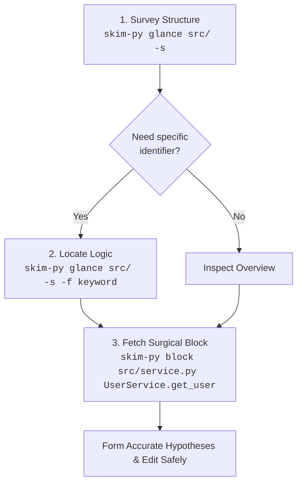

# `skim-py`

[](https://pypi.org/project/skim-python/)
[](../../LICENSE)

A fast, zero-dependency, AST-resilient Python outline and verbatim code block extractor tailored for AI coding agents and terminal workflows.

> Part of the [`skim-*` family - check out the complete suite](https://github.com/benedictjohannes/programming-helper-utils). Conforms to the [`skim-*` Family Design Specification](https://github.com/benedictjohannes/programming-helper-utils/blob/master/Design.Skim.md).

---

## Why `skim-py`?

When AI coding assistants (such as Claude, Gemini, ChatGPT, or Cursor) operate on real-world Python repositories, reading entire source files into prompt context leads to performance and cost degradation:

1. **Context Window Exhaustion & Attention Drift**: Dumping 1,000–5,000 line source files burns through token budgets rapidly. Irrelevant implementation details dilute the model's attention, leading to hallucinations and missed context.
2. **The Test Bloat Trap**: In modern Python codebases, test files (`test_*.py`, `*_test.py`, `tests/`) and in-file test suites (`class Test*`, `def test_*`) often make up 50–70% of a repository's volume. When exploring domain logic or architecture, test suites add immense noise.
3. **Repeated File Reading Loops**: Agents often read file A, find a call to a method on class B in file B, read all of file B, and repeat—quickly exhausting tool calls and context windows.
4. **Syntax Tolerance During Active Edits**: Codebases being actively refactored or edited often contain temporary syntax errors. Traditional strict parsers crash completely, leaving the agent unable to inspect surrounding structures.

`skim-py` solves this by giving agents (and developers) a pair of surgical tools powered by Python's built-in `ast` and `tokenize` modules (zero third-party dependencies):
- **`glance`**: Instant, high-density outlines of declarations, signatures, dataclass/Pydantic/enum fields, and line spans—with test files and in-file test suites filtered out by default.
- **`block`**: Verbatim code retrieval for an exact class, function, or qualified member (`Class.method`) with line gutters or raw code ready for editing.

---

## Recommended Agent Workflow



1. **Survey (`glance -s`)**: Get the structural topography of a module or package in under 100 tokens.
2. **Locate (`glance -f <keyword>`)**: Narrow down matching declarations across files with case-insensitive substring filters.
3. **Inspect (`block <file> <target>`)**: Fetch the exact verbatim implementation block with accurate file line numbers for precision editing.

---

## Features

- **Zero Third-Party Dependencies**: Pure Python standard library implementation using `ast` and `tokenize`.
- **Fast Startup & Minimal Overhead**: Launches instantaneously without waiting for heavy virtual environments or complex toolchains.
- **Test-Blind by Default**:
  - Automatically excludes `test_*.py`, `*_test.py`, `conftest.py`, and test directories (`tests/`, `test/`, `testing/`, `__tests__/`) during traversals unless `-t` / `--include-tests` is specified.
  - Automatically detects in-file test classes (`Test*`, `unittest.TestCase`) and test functions (`test_*`) and filters them out of outlines and target lookups, reporting skipped line ranges (`[tests skipped: 8..9, 16..17, 20..25]`).
- **Language-Idiomatic Qualified Targets**: Target methods via `Class.method`, constructors via `Class.__init__`, dunder methods via `Class.__str__`, or standalone functions, classes, and module-level variables.
- **Decorator & Signature Preservation**: Includes full decorator chains (`@classmethod`, `@property`, `@field_validator`) and return annotations in both outlines and block extractions.
- **Exact-Case Precedence with Case-Insensitive Fallback**: Matches `basemodel.model_dump` to `BaseModel.model_dump` while prioritizing exact case if both co-exist.
- **Clear Ambiguity Diagnostics**: If a target matches multiple candidates, `skim-py` exits with code `3` and presents numbered candidate locations with line spans and disambiguation tips.
- **Syntax Error Tolerance & AST Recovery**:
  - Reports syntax notices cleanly under the file header without crashing, pinpointing the error line and message.
  - Automatically recovers using a bounded iterative line-masking fallback (up to 100 iterations), isolating broken lines while preserving exact 1-to-1 line offsets so surrounding valid classes, methods, and functions remain fully outlined and extractable.

---

## Installation & Usage

### On-Demand (`uvx` or `pipx`)
Run directly without installing:

```bash
# Via uvx (Fastest & Recommended)
uvx --from skim-python skim-py glance src/ -s
uvx --from skim-python skim-py block src/models.py BaseModel

# Via pipx
pipx run --spec skim-python skim-py glance src/ -s
```

### Global Install (`uv` / `pipx` / `pip`)
Install globally to add `skim-py` directly to your `PATH`:

```bash
# Via uv (Recommended)
uv tool install skim-python

# Via pipx
pipx install skim-python

# Via pip
pip install skim-python
```

### From Local Source

```bash
git clone https://github.com/benedictjohannes/programming-helper-utils.git
cd programming-helper-utils/python/skim-py

# With uv:
uv tool install --editable .

# Or with pip:
pip install -e .

# Or link the standalone runner directly to your PATH:
mkdir -p ~/.local/bin
ln -sf "$(pwd)/skim-py" ~/.local/bin/skim-py
```

---

## CLI Reference & Concrete Examples

> [!NOTE]
> Examples below are authentic outputs produced by running `skim-py` against the [`pydantic/pydantic`](https://github.com/pydantic/pydantic) repository and local fixtures.

```text
Usage:
  skim-py glance [options] <path>...
  skim-py block  [options] <file> <target>
```

---

### 1. `glance` Subcommand

Outlines structure, signatures, fields, and imports across files or directories.

```text
Usage:
  skim-py glance [options] <path>...

Arguments:
  <path>...                 One or more source files, directories, or globs

Options:
  -s, --signatures          Show declarations & types without function bodies
  -d, --details             Show class attributes, annotated fields, and enum members
  -u, --uses, --imports     Display top-level import statements
  -f, --filter <text>       Filter items containing <text> (case-insensitive, repeatable)
  -t, --include-tests       Include test files (test_*.py, etc.) and test blocks
```

#### Example 1: Basic Structural Outline of a File

```bash
skim-py glance testingRepositories/pydantic/pydantic/errors.py
```
```text
=== testingRepositories/pydantic/pydantic/errors.py (185 lines) ===

Outline:
  L15-L23      var __all__
  L28-L28      var DEV_ERROR_DOCS_URL
  L82-L98      class PydanticErrorMixin
  L90-L92        method __init__
  L94-L98        method __str__
  L101-L102    class PydanticUserError
  L105-L127    class PydanticUndefinedAnnotation
  L113-L115      method __init__
  L117-L127      method from_name_error
  L130-L138    class PydanticImportError
  L137-L138      method __init__
  L141-L149    class PydanticSchemaGenerationError
  L148-L149      method __init__
  L152-L160    class PydanticInvalidForJsonSchema
  L159-L160      method __init__
  L163-L182    class PydanticForbiddenQualifier
  L175-L182      method __init__
  L185-L185    var __getattr__
```

#### Example 2: Signatures and Imports (`-s -u`)

```bash
skim-py glance testingRepositories/pydantic/pydantic/errors.py -s -u
```
```text
=== testingRepositories/pydantic/pydantic/errors.py (185 lines) ===

Imports:
  from __future__ import annotations as _annotations
  from typing import Any, ClassVar, Literal
  from typing_extensions import Self
  from typing_inspection.introspection import Qualifier
  from pydantic._internal import _repr
  from ._migration import getattr_migration
  from .version import version_short

Outline:
  L15-L23      __all__ = ('PydanticUserError', 'PydanticUndefinedAnnotation', 'PydanticImportError', 'PydanticSchemaGenerationError', 'PydanticInvalidForJsonSchema', 'PydanticForbiddenQualifier', 'PydanticErrorCodes')
  L28-L28      DEV_ERROR_DOCS_URL = f'https://errors.pydantic.dev/{version_short()}/u/'
  L82-L98      class PydanticErrorMixin
  L90-L92        def __init__(self, message: str, *, code: PydanticErrorCodes | None) -> None
  L94-L98        def __str__(self) -> str
  L101-L102    class PydanticUserError(PydanticErrorMixin, RuntimeError)
  L105-L127    class PydanticUndefinedAnnotation(PydanticErrorMixin, NameError)
  L113-L115      def __init__(self, name: str | None, message: str) -> None
  L117-L127      @classmethod def from_name_error(cls, name_error: NameError) -> Self
  L130-L138    class PydanticImportError(PydanticErrorMixin, ImportError)
  L137-L138      def __init__(self, message: str) -> None
  L141-L149    class PydanticSchemaGenerationError(PydanticUserError)
  L148-L149      def __init__(self, message: str) -> None
  L152-L160    class PydanticInvalidForJsonSchema(PydanticUserError)
  L159-L160      def __init__(self, message: str) -> None
  L163-L182    class PydanticForbiddenQualifier(PydanticUserError)
  L175-L182      def __init__(self, qualifier: Qualifier, annotation: Any) -> None
  L185-L185    __getattr__ = getattr_migration(__name__)
```

#### Example 3: Expand Details and Class Attributes (`-s -d`)

```bash
skim-py glance testingRepositories/pydantic/pydantic/errors.py -s -d
```
```text
=== testingRepositories/pydantic/pydantic/errors.py (185 lines) ===

Outline:
  L15-L23      __all__ = ('PydanticUserError', 'PydanticUndefinedAnnotation', 'PydanticImportError', 'PydanticSchemaGenerationError', 'PydanticInvalidForJsonSchema', 'PydanticForbiddenQualifier', 'PydanticErrorCodes')
  L28-L28      DEV_ERROR_DOCS_URL = f'https://errors.pydantic.dev/{version_short()}/u/'
  L82-L98      class PydanticErrorMixin
  L90-L92        def __init__(self, message: str, *, code: PydanticErrorCodes | None) -> None
  L94-L98        def __str__(self) -> str
  L101-L102    class PydanticUserError(PydanticErrorMixin, RuntimeError)
  L105-L127    class PydanticUndefinedAnnotation(PydanticErrorMixin, NameError)
  L113-L115      def __init__(self, name: str | None, message: str) -> None
  L117-L127      @classmethod def from_name_error(cls, name_error: NameError) -> Self
  L130-L138    class PydanticImportError(PydanticErrorMixin, ImportError)
  L137-L138      def __init__(self, message: str) -> None
  L141-L149    class PydanticSchemaGenerationError(PydanticUserError)
  L148-L149      def __init__(self, message: str) -> None
  L152-L160    class PydanticInvalidForJsonSchema(PydanticUserError)
  L159-L160      def __init__(self, message: str) -> None
  L163-L182    class PydanticForbiddenQualifier(PydanticUserError)
                 | _qualifier_repr_map: ClassVar[dict[Qualifier, str]] = {'required': 'typing.Required', 'not_required': 'typing.NotRequired', 'read_only': 'typing.ReadOnly', 'class_var': 'typing.ClassVar', 'init_var': 'dataclasses.InitVar', 'final': 'typing.Final'}
  L175-L182      def __init__(self, qualifier: Qualifier, annotation: Any) -> None
  L185-L185    __getattr__ = getattr_migration(__name__)
```

#### Example 4: Filter by Keyword across Declarations (`-f <keyword>`)

```bash
skim-py glance testingRepositories/pydantic/pydantic/errors.py -s -f "from_name_error"
```
```text
=== testingRepositories/pydantic/pydantic/errors.py (185 lines) ===

Outline:
  L105-L127    class PydanticUndefinedAnnotation(PydanticErrorMixin, NameError)
  L117-L127      @classmethod def from_name_error(cls, name_error: NameError) -> Self
```

#### Example 5: In-File Test Filtering & Inclusion (`-t`)

In-file test suites (`Test*`, `test_*`) are filtered out by default, with skipped ranges highlighted:

```bash
# Default: in-file tests omitted
skim-py glance tests/fixtures/tests.py
```
```text
=== tests/fixtures/tests.py (29 lines) [tests skipped: 8..9, 16..17, 20..25, 28..29] ===

Outline:
  L4-L5        function normal_helper
  L12-L17      class NormalClass
  L13-L14        method regular_method
```

When test inspection is desired, pass `-t`:

```bash
skim-py glance tests/fixtures/tests.py -t
```
```text
=== tests/fixtures/tests.py (29 lines) [test] ===

Outline:
  L4-L5        function normal_helper
  L8-L9        def test_helper_not_test() -> str
  L12-L17      class NormalClass
  L13-L14        method regular_method
  L16-L17        def test_like_method(self) -> None
  L20-L25      class TestSuite(unittest.TestCase)
  L21-L22        def test_example(self) -> None
  L24-L25        def test_another(self) -> None
  L28-L29      def test_standalone_func() -> None
```

Similarly, test files (`test_*.py`, `tests/`) are excluded by default during directory traversals and only included when `-t` is passed:

```bash
skim-py glance testingRepositories/pydantic/tests/test_warnings.py -t
```
```text
=== testingRepositories/pydantic/tests/test_warnings.py (41 lines) [test] ===

Outline:
  L5-L10       def test_pydantic_deprecation_warning()
  L13-L17      def test_pydantic_deprecation_warning_tailing_dot_in_message()
  L20-L23      def test_pydantic_deprecation_warning_calculated_expected_removal()
  L26-L32      def test_pydantic_deprecation_warning_2_0_migration_guide_link()
  L35-L41      def test_pydantic_deprecated_since_2_0_warning()
```

#### Example 6: Syntax Error Tolerance & Recovery

If a file has a syntax error during active editing or refactoring, `skim-py` does not crash; it pinpoints syntax errors directly under the file header and automatically recovers to outline valid surrounding declarations:

```bash
skim-py glance tests/fixtures/syntax_error.py -s
```
```text
=== tests/fixtures/syntax_error.py (12 lines) [! 1 syntax error] ===
# parsed with 1 line masked (L7)
  Syntax Notice: L7: invalid syntax

Outline:
  L1-L2        def valid_before()
  L5-L8        def broken_function()
  L11-L12      def valid_after()
```

Surrounding valid functions remain fully extractable via `block` (masking warnings are surfaced via stderr):

```bash
skim-py block tests/fixtures/syntax_error.py valid_after
```
```text
tests/fixtures/syntax_error.py: # parsed with 1 line masked (L7)
=== tests/fixtures/syntax_error.py (L11-L12) ===
   11 | def valid_after():
   12 |     return 2
```

And if an extracted block contains a syntax error within its line span, the warning is surfaced directly above the block:

```bash
skim-py block tests/fixtures/syntax_error.py broken_function
```
```text
tests/fixtures/syntax_error.py: # parsed with 1 line masked (L7)
=== tests/fixtures/syntax_error.py (L5-L8) [! 1 syntax error] ===
  Syntax Notice: L7: invalid syntax
    5 | def broken_function():
    6 |     x = 10
    7 |     y =
    8 |     return x
```

For cascade-prone mid-edit states (such as an unclosed `def foo(x,` header or unclosed bracket structure), `skim-py` masks the entire broken block in one step, marks the masked line range in the notice, and salvages the broken declaration in the outline so it remains targetable by `block`:

```bash
skim-py glance tests/fixtures/syntax_error_cascade.py -s
```
```text
=== tests/fixtures/syntax_error_cascade.py (11 lines) [! 1 syntax error] ===
# parsed with 3 lines masked (L5, L6, L7)
  Syntax Notice: L5: '(' was never closed (L5-L7 masked)

Outline:
  L1-L2        def valid_before()
  L5-L7        def broken_header [syntax error]
  L10-L11      def valid_after()
```

```bash
skim-py block tests/fixtures/syntax_error_cascade.py broken_header
```
```text
tests/fixtures/syntax_error_cascade.py: # parsed with 3 lines masked (L5, L6, L7)
=== tests/fixtures/syntax_error_cascade.py (L5-L7) [! 1 syntax error] ===
  Syntax Notice: L5: '(' was never closed (L5-L7 masked)
    5 | def broken_header(x,
    6 |     y = 1
    7 |     return y
```

---

### 2. `block` Subcommand

Extracts the exact verbatim source block for a class, function, variable, or `Class.method`.

```text
Usage:
  skim-py block [options] <file> <target>

Arguments:
  <file>                    Path to the source file
  <target>                  Name of class, method, function, or Class.method

Options:
  -t, --include-tests       Search inside test files and test blocks
  --raw                     Omit line number gutter (clean code for edits/diffs)
```

#### Example 7: Extract Class Definition

```bash
skim-py block testingRepositories/pydantic/pydantic/warnings.py PydanticDeprecationWarning
```
```text
=== testingRepositories/pydantic/pydantic/warnings.py (L23-L54) ===
   23 | class PydanticDeprecationWarning(DeprecationWarning):
   24 |     """A Pydantic specific deprecation warning.
   25 | 
   26 |     This warning is raised when using deprecated functionality in Pydantic. It provides information on when the
   27 |     deprecation was introduced and the expected version in which the corresponding functionality will be removed.
   28 | 
   29 |     Attributes:
   30 |         message: Description of the warning.
   31 |         since: Pydantic version in what the deprecation was introduced.
   32 |         expected_removal: Pydantic version in what the corresponding functionality expected to be removed.
   33 |     """
   34 | 
   35 |     message: str
   36 |     since: tuple[int, int]
   37 |     expected_removal: tuple[int, int]
   38 | 
   39 |     def __init__(
   40 |         self, message: str, *args: object, since: tuple[int, int], expected_removal: tuple[int, int] | None = None
   41 |     ) -> None:
   42 |         super().__init__(message, *args)
   43 |         self.message = message.rstrip('.')
   44 |         self.since = since
   45 |         self.expected_removal = expected_removal if expected_removal is not None else (since[0] + 1, 0)
   46 | 
   47 |     def __str__(self) -> str:
   48 |         message = (
   49 |             f'{self.message}. Deprecated in Pydantic V{self.since[0]}.{self.since[1]}'
   50 |             f' to be removed in V{self.expected_removal[0]}.{self.expected_removal[1]}.'
   51 |         )
   52 |         if self.since == (2, 0):
   53 |             message += f' See Pydantic V2 Migration Guide at https://errors.pydantic.dev/{version_short()}/migration/'
   54 |         return message
```

#### Example 8: Extract Qualified Method (`Class.method`)

```bash
skim-py block testingRepositories/pydantic/pydantic/errors.py PydanticUndefinedAnnotation.from_name_error
```
```text
=== testingRepositories/pydantic/pydantic/errors.py (L117-L127) ===
  117 |     @classmethod
  118 |     def from_name_error(cls, name_error: NameError) -> Self:
  119 |         """Convert a `NameError` to a `PydanticUndefinedAnnotation` error.
  120 | 
  121 |         Args:
  122 |             name_error: `NameError` to be converted.
  123 | 
  124 |         Returns:
  125 |             Converted `PydanticUndefinedAnnotation` error.
  126 |         """
  127 |         return cls(name=name_error.name, message=str(name_error))
```

Case-insensitive target matching is also supported:

```bash
skim-py block testingRepositories/pydantic/pydantic/errors.py pydanticundefinedannotation.from_name_error
```

#### Example 9: Raw Output for Seamless Patching (`--raw`)

```bash
skim-py block testingRepositories/pydantic/pydantic/errors.py PydanticUndefinedAnnotation.from_name_error --raw
```
```python
    @classmethod
    def from_name_error(cls, name_error: NameError) -> Self:
        """Convert a `NameError` to a `PydanticUndefinedAnnotation` error.

        Args:
            name_error: `NameError` to be converted.

        Returns:
            Converted `PydanticUndefinedAnnotation` error.
        """
        return cls(name=name_error.name, message=str(name_error))
```

#### Example 10: Disambiguation Handling

When multiple candidates match an ambiguous target name, `skim-py` exits with status `3` and provides candidates and resolution tips:

```bash
skim-py block testingRepositories/pydantic/pydantic/errors.py __init__
```
```text
Error: ambiguous target '__init__' matched 6 candidates in testingRepositories/pydantic/pydantic/errors.py:
  1) L90-L92    method PydanticErrorMixin.__init__
  2) L113-L115  method PydanticUndefinedAnnotation.__init__
  3) L137-L138  method PydanticImportError.__init__
  4) L148-L149  method PydanticSchemaGenerationError.__init__
  5) L159-L160  method PydanticInvalidForJsonSchema.__init__
  6) L175-L182  method PydanticForbiddenQualifier.__init__

Tip: Disambiguate with Class.method (e.g. BaseModel.model_dump) or read line range directly.
```

---

## Exit Codes

`skim-py` adheres to the standardized POSIX / `skim-*` family exit codes:

| Code | Meaning | Description |
|:---:|:---|:---|
| `0` | **Success** | Operation completed normally. |
| `1` | **Error** | Path not found, I/O failure, or invalid CLI flag. |
| `2` | **Not Found** | The specified target symbol was not found in the file. |
| `3` | **Ambiguous** | Multiple candidates match the target symbol; disambiguation required. |

---

## Automated Tests

Unit tests and edge-case fixtures are located in [`tests/`](tests/).

Run test suite via `pytest`:
```bash
pytest tests/
```

---

## License

MIT
