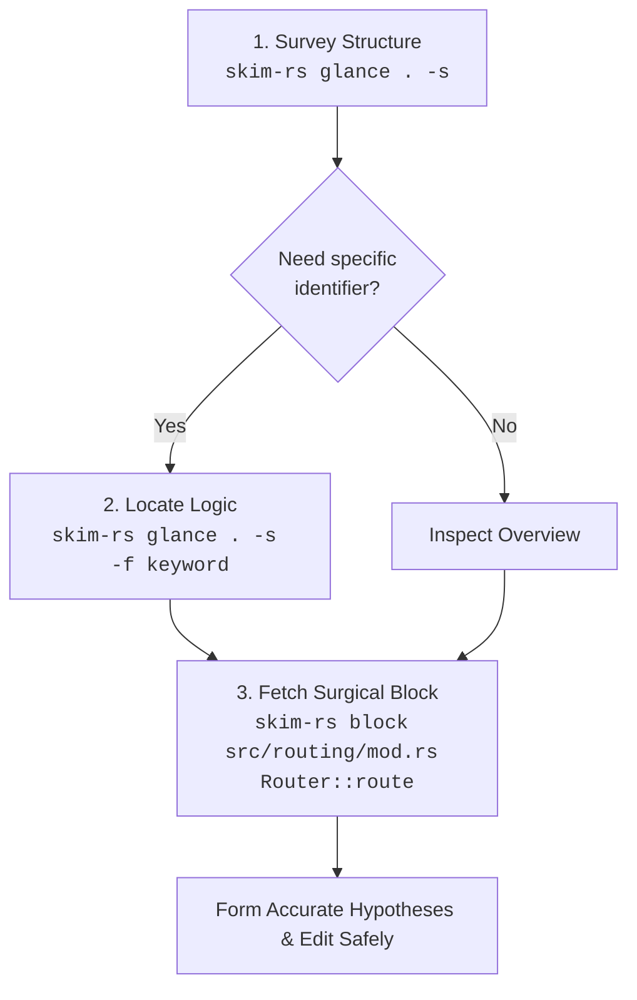

# `skim-rs`

A fast, lossless, AST-resilient Rust outline and verbatim code block extractor tailored for AI coding agents and terminal workflows.

Conforms to the [`skim-*` Family Design Specification](../../Design.md).

---

## Why `skim-rs`?

When AI coding assistants (such as Claude, Gemini, ChatGPT, or Cursor) operate on real-world Rust repositories, reading entire source files into prompt context leads to performance and cost degradation:

1. **Context Window Exhaustion & Attention Drift**: Dumping 1,000–3,000 line source files burns through token budgets rapidly. More critically, irrelevant implementation details dilute the model's attention, leading to hallucinations and missed context.
2. **The Rust Test Bloat Trap**: In Rust codebases, unit tests inside `#[cfg(test)] mod tests { ... }` or files inside `tests/` often constitute 50–70% of a repository's volume. Ingestion of test suites during architectural or logic exploration creates severe prompt clutter.
3. **Repeated File Reading Loops**: Agents often read file A, find a call to a method on struct B in file B, read all of file B, and repeat—quickly exhausting tool call limits and token budgets.
4. **Syntax Tolerance During Edits**: Codebases being actively refactored or edited often have syntax errors. Traditional strict parsers fail completely (`syn` halts on broken syntax), leaving the agent unable to inspect surrounding structures.

`skim-rs` solves this by giving agents (and developers) a pair of surgical tools powered by Rust Analyzer's error-resilient parser (`ra_ap_syntax`):
- **`glance`**: Instant, high-density outlines of declarations, signatures, struct fields/enum variants, and line spans—with `tests/` directories, `#[cfg(test)]` modules, and test functions filtered out by default.
- **`block`**: Verbatim code retrieval for an exact struct, enum, trait, function, or qualified member (`Type::method` / `Router::route`) with line gutters or raw code ready for editing.

---

## Recommended Agent Workflow



1. **Survey (`glance -s`)**: Get the structural topography of a crate or module in under 100 tokens.
2. **Locate (`glance -f <keyword>`)**: Narrow down matching items/blocks across files with case-insensitive substring filters (matches declarations, member details, or block bodies; repeatable for AND matching).
3. **Inspect (`block <file> <target>`)**: Fetch the exact verbatim implementation block with accurate file line numbers for precision editing.

---

## Features

- **Rust Analyzer AST Engine (`ra_ap_syntax`)**: Lossless syntax tree parser. Unlike `syn`, it parses incomplete or syntactically invalid code gracefully, displaying syntax notices without crashing or skipping valid declarations.
- **Test-Blind by Default**:
  - Automatically excludes `tests/` directories and `*_test.rs` files during directory and pattern traversals unless `-t` / `--include-tests` is specified.
  - Automatically filters out `#[cfg(test)] mod tests`, `#[test]`, `#[tokio::test]`, and `test_*` functions inside files unless `-t` is passed.
- **Member `Type::method` Resolution**:
  - Resolves methods in inherent impls (`impl Router { fn route(...) }`) and trait impls (`impl Service for Router { fn call(...) }`) via `Type::method` syntax.
- **Exact-Case Precedence with Case-Insensitive Fallback**: Matches `router::route` to `Router::route` while prioritizing exact case if both `struct Config` and `fn config()` coexist.
- **Clear Ambiguity Diagnostics**: When a target matches multiple candidates (e.g. module `route` vs method `Router::route`), `skim-rs` exits with code `3` and lists candidate locations with line spans and disambiguation guidance.
- **Blazing Fast**: Native compiled static binary with near-instant execution (<10ms).

---

## Installation

### Via `cargo install` (Recommended)

From [crates.io](https://crates.io/crates/skim-rs):

```bash
cargo install skim-rs
```

Ensure `~/.cargo/bin` is in your `PATH`.

### From Source

Requires Rust 1.85+ (Edition 2024):

```bash
git clone https://github.com/benedictjohannes/programming-helper-utils.git
cd programming-helper-utils/rust/skim-rs
cargo install --path .
```

---

## CLI Reference & Concrete Examples

> [!NOTE]
> All examples below are authentic, unedited outputs produced by running `skim-rs` against the real-world [`tokio-rs/axum`](https://github.com/tokio-rs/axum) repository.

```text
Usage:
  skim-rs glance [options] <path>...
  skim-rs block  [options] <file> <target>
```

---

### 1. `glance` Subcommand

Outlines structure, signatures, struct fields/enum variants, and imports across files or directories.

```text
Usage:
  skim-rs glance [options] <path>...

Arguments:
  <path>...                 One or more .rs files, directories, or globs

Options:
  -s, --signatures          Show declarations & types without function bodies
  -d, --details             Show struct fields, interface members, and enum variants
  -u, --uses, --imports     Display top-level imports and uses
  -f, --filter <text>       Filter items containing <text> (within block or declaration, case-insensitive, repeatable for AND)
  -t, --include-tests       Include test files, test modules, and test functions
```

#### Example 1: Basic Structural Outline of a File

```bash
skim-rs glance axum/src/form.rs
```
```text
=== axum/src/form.rs (283 lines) ===

Outline:
  L9-L71       struct Form
  L78-L78      type Rejection
  L80-L104     fn from_request
  L111-L130    fn into_response
```

#### Example 2: Signatures and Imports (`-s -u`)

```bash
skim-rs glance axum/src/form.rs -s -u
```
```text
=== axum/src/form.rs (283 lines) ===

Imports:
  use crate::extract::Request;
  use crate::extract::{rejection::*, FromRequest, RawForm};
  use axum_core::response::{IntoResponse, IntoResponseFailed, Response};
  use axum_core::RequestExt;
  use http::header::CONTENT_TYPE;
  use http::StatusCode;
  use serde_core::{de::DeserializeOwned, Serialize};

Outline:
  L9-L71       pub struct Form<T>
  L78-L78      type Rejection = FormRejection
  L80-L104     async fn from_request(req: Request, _state: &S) -> Result<Self, Self::Rejection>
  L111-L130    fn into_response(self) -> Response
```

#### Example 3: Expand Struct Fields & Types (`-d`)

```bash
skim-rs glance axum/src/form.rs -s -d
```
```text
=== axum/src/form.rs (283 lines) ===

Outline:
  L9-L71       pub struct Form<T>
      | pub T
  L78-L78      type Rejection = FormRejection
  L80-L104     async fn from_request(req: Request, _state: &S) -> Result<Self, Self::Rejection>
  L111-L130    fn into_response(self) -> Response
```

#### Example 4: Filter by Keyword across Declarations and Blocks (`-f <keyword>`)

Matches declarations, struct/enum details, or verbatim block contents (e.g. searching for `content_type.starts_with` which only appears inside the function body):

```bash
skim-rs glance axum/src/extract/mod.rs -f "content_type.starts_with"
```
```text
=== axum/src/extract/mod.rs (113 lines) ===

Outline:
  L85-L96      fn has_content_type
```

Combined with `-s` to display signatures:

```bash
skim-rs glance axum/src/extract/mod.rs -s -f "has_content_type"
```
```text
=== axum/src/extract/mod.rs (113 lines) ===

Outline:
  L85-L96      pub(super) fn has_content_type(headers: &HeaderMap, expected_content_type: &mime::Mime) -> bool
```

#### Example 5: In-File Test Filtering & Inclusion (`-t`)

Rust unit tests annotated with `#[test]` or enclosed in `#[cfg(test)]` modules are excluded by default:

```bash
# Default: unit tests omitted
skim-rs glance axum/src/error_handling/mod.rs
```
```text
=== axum/src/error_handling/mod.rs (263 lines) ===

Outline:
  L19-L26      struct HandleErrorLayer
  L29-L35      fn new
  L42-L47      fn clone
  L51-L55      fn fmt
  L62-L62      type Service
  L64-L66      fn layer
  L69-L76      struct HandleError
  L79-L86      fn new
  L94-L100     fn clone
  L107-L112    fn fmt
  L126-L126    type Response
  L127-L127    type Error
  L128-L128    type Future
  L130-L132    fn poll_ready
  L134-L148    fn call
  L151-L205    macro impl_service
  L224-L254    mod future
```

When test inspection is desired, pass `-t`:

```bash
skim-rs glance axum/src/error_handling/mod.rs -t
```
```text
=== axum/src/error_handling/mod.rs (263 lines) ===

Outline:
  ...
  L224-L254    mod future
  L256-L262    fn traits
```

#### Example 6: Syntax Error Tolerance & Reporting

If a file has a syntax error during refactoring or active edits, `skim-rs` will not crash; it pinpoints syntax errors right under the file header and outlines valid declarations:

```bash
skim-rs glance fixtures/broken.rs -s
```
```text
=== fixtures/broken.rs (13 lines) [! 1 syntax error] ===
  Syntax Notice: L6: expected SEMICOLON

Outline:
  L1-L3        pub struct WorkingConfig
  L5-L8        fn broken_function()
  L10-L12      pub struct AnotherValidStruct
```

---

### 2. `block` Subcommand

Extracts the exact verbatim source block for a type, function, or `Type::method`.

```text
Usage:
  skim-rs block [options] <file> <target>

Arguments:
  <file>                    Path to the .rs file
  <target>                  Name of type, fn, macro, or Type::method

Options:
  -t, --include-tests       Search inside test functions/modules
  --raw                     Omit line number gutter (clean code for edits/diffs)
```

#### Example 7: Extract Struct Definition

```bash
skim-rs block axum/src/response/mod.rs NoContent
```
```text
=== axum/src/response/mod.rs (L61-L78) ===
   61 | /// An empty response with 204 No Content status.
   62 | ///
   63 | /// Due to historical and implementation reasons, the `IntoResponse` implementation of `()`
   64 | /// (unit type) returns an empty response with 200 [`StatusCode::OK`] status.
   65 | /// If you specifically want a 204 [`StatusCode::NO_CONTENT`] status, you can use either `StatusCode` type
   66 | /// directly, or this shortcut struct for self-documentation.
   67 | ///
   68 | /// ```
   69 | /// use axum::{extract::Path, response::NoContent};
   70 | ///
   71 | /// async fn delete_user(Path(user): Path<String>) -> Result<NoContent, String> {
   72 | ///     // ...access database...
   73 | /// # drop(user);
   74 | ///     Ok(NoContent)
   75 | /// }
   76 | /// ```
   77 | #[derive(Debug, Clone, Copy)]
   78 | pub struct NoContent;
```

#### Example 8: Extract Qualified Method (`Type::method`)

```bash
skim-rs block axum/src/routing/mod.rs Router::route
```
```text
=== axum/src/routing/mod.rs (L183-L189) ===
  183 |     #[doc = include_str!("../docs/routing/route.md")]
  184 |     #[track_caller]
  185 |     pub fn route(self, path: &str, method_router: MethodRouter<S>) -> Self {
  186 |         tap_inner!(self, mut this => {
  187 |             panic_on_err!(this.path_router.route(path, method_router));
  188 |         })
  189 |     }
```

Case-insensitive target matching is supported:

```bash
skim-rs block axum/src/routing/mod.rs router::route
```

#### Example 9: Raw Output for Seamless Patching (`--raw`)

```bash
skim-rs block axum/src/routing/mod.rs Router::route --raw
```
```rust
    #[doc = include_str!("../docs/routing/route.md")]
    #[track_caller]
    pub fn route(self, path: &str, method_router: MethodRouter<S>) -> Self {
        tap_inner!(self, mut this => {
            panic_on_err!(this.path_router.route(path, method_router));
        })
    }
```

#### Example 10: Disambiguation Handling

When multiple candidates match an ambiguous target name, `skim-rs` exits with status `3` and provides candidates and resolution tips:

```bash
skim-rs block axum/src/routing/mod.rs route
```
```text
Ambiguous target 'route' matched 2 candidates in axum/src/routing/mod.rs:
  1) L36-L36   mod route
  2) L183-L189   fn Router::route

Tip: Disambiguate with Type::method (e.g. Router::route) or read line range directly.
```

#### Example 11: Syntax Notice Inside Extracted Block

If an extracted block contains a syntax error, the warning is surfaced directly above the block:

```bash
skim-rs block fixtures/broken.rs broken_function
```
```text
=== fixtures/broken.rs (L5-L8) [! 1 syntax error] ===
  Syntax Notice: L6: expected SEMICOLON
    5 | fn broken_function() {
    6 |     let x = 10
    7 |     let y = 20;
    8 | }
```

---

## Exit Codes

`skim-rs` adheres to standardized POSIX / CLI exit codes:

| Code | Meaning |
|:---:|:---|
| `0` | **Success**: Operation completed normally. |
| `1` | **Error**: Path not found, I/O failure, or invalid CLI flag. |
| `2` | **Not Found**: The specified target symbol was not found in the file. |
| `3` | **Ambiguous**: Multiple candidates match the target symbol; disambiguation required. |

---

## License

MIT
