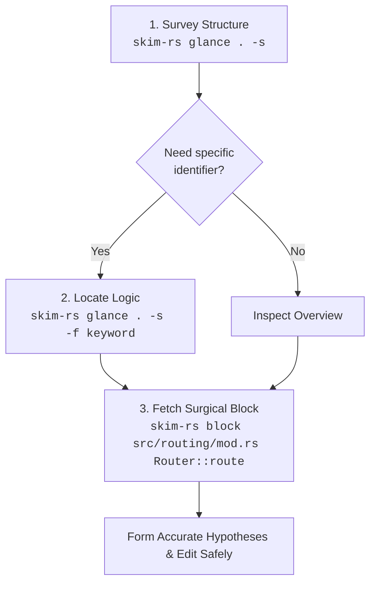

# `skim-rs`

[](https://crates.io/crates/skim-rs)
[](LICENSE)

A fast, lossless, AST-resilient Rust outline and verbatim code block extractor tailored for AI coding agents and terminal workflows.

> Part of the [`skim-*` family - check out the complete suite](https://github.com/benedictjohannes/programming-helper-utils). Conforms to the [`skim-*` Family Design Specification](https://github.com/benedictjohannes/programming-helper-utils/blob/master/Design.Skim.md).

---

## Why `skim-rs`?

When AI coding assistants (such as Claude, Gemini, ChatGPT, or Cursor) operate on real-world Rust repositories, reading entire source files into prompt context leads to performance and cost degradation:

1. **Context Window Exhaustion & Attention Drift**: Dumping 1,000–3,000 line source files burns through token budgets rapidly. More critically, irrelevant implementation details dilute the model's attention, leading to hallucinations and missed context.
2. **The Rust Test Bloat Trap**: In Rust codebases, unit tests inside `#[cfg(test)] mod tests { ... }` or files inside `tests/` often constitute 50–70% of a repository's volume. Ingestion of test suites during architectural or logic exploration creates severe prompt clutter.
3. **Repeated File Reading Loops**: Agents often read file A, find a call to a method on struct B in file B, read all of file B, and repeat—quickly exhausting tool call limits and token budgets.
4. **Syntax Tolerance During Edits**: Codebases being actively refactored or edited often have syntax errors. Traditional strict parsers fail completely (`syn` halts on broken syntax), leaving the agent unable to inspect surrounding structures.

`skim-rs` solves this by giving agents (and developers) a pair of surgical tools powered by Rust Analyzer's error-resilient parser (`ra_ap_syntax`):
- **`glance`**: Instant, high-density outlines of declarations, signatures, struct fields/enum variants, and line spans—with `tests/` directories, `#[cfg(test)]` modules, and test functions filtered out by default.
- **`block`**: Verbatim code retrieval for an exact struct, enum, trait, function, or qualified member (`Type::method` / `Router::route`) with line gutters or raw code ready for editing.

---

## Recommended Agent Workflow



1. **Survey (`glance -s`)**: Get the structural topography of a crate or module in under 100 tokens.
2. **Locate (`glance -f <keyword>`)**: Narrow down matching items/blocks across files with case-insensitive substring filters (matches declarations, member details, or block bodies; repeatable for AND matching).
3. **Inspect (`block <file> <target>`)**: Fetch the exact verbatim implementation block with accurate file line numbers for precision editing.

---

## Features

- **Rust Analyzer AST Engine (`ra_ap_syntax`)**: Lossless syntax tree parser. Unlike `syn`, it parses incomplete or syntactically invalid code gracefully, displaying syntax notices without crashing or skipping valid declarations.
- **Test-Blind by Default**:
  - Automatically excludes `tests/` directories and `*_test.rs` files during directory and pattern traversals unless `-t` / `--include-tests` is specified.
  - Automatically filters out `#[cfg(test)]` modules, `#[test]`, `#[tokio::test]`, `#[rstest]` and `#[test_case]` items inside files unless `-t` is passed. Detection is attribute-based: a function merely *named* `test_connection` is regular code.
- **Comment-Free Outlines**: `-s` and `-d` never print doc comments, attributes or comments embedded in a signature (`fn add(/* a */ x: i32, // note\n y: i32)` prints as `fn add(x: i32, y: i32)`). Use `block` to read them.
- **Impl-Aware Outlines**: `impl` blocks are printed as a header (with its line span) followed by their members, so you can see at a glance which trait a method belongs to. Members taking `self` are labeled `method`; associated functions such as `new` stay `fn`.
- **Inline Modules Are Outlined**: `mod foo { ... }` is expanded recursively with indentation per nesting level. Out-of-line `mod foo;` declarations are listed but never followed, keeping each invocation single-file.
- **Member `Type::method` Resolution**:
  - Resolves methods in inherent impls (`impl Router { fn route(...) }`) and trait impls (`impl Service for Router { fn call(...) }`) via `Type::method` syntax, at any module depth (`future::HandleErrorFuture::poll`, or any trailing path suffix).
  - Accepts Rust qualified paths (`'<Type as Trait>::method'`, `'<Type>::method'`) to pick one impl when `Type::method` is ambiguous (e.g. `Display::fmt` vs `Debug::fmt`).
- **Exact-Case Precedence with Case-Insensitive Fallback**: Matches `router::route` to `Router::route` while prioritizing exact case if both `struct Config` and `fn config()` coexist.
- **Clear Ambiguity Diagnostics**: When a target matches multiple candidates (e.g. module `route` vs method `Router::route`), `skim-rs` exits with code `3` and lists every candidate with its line span, as a copy-pasteable Rust qualified path for impl members, plus disambiguation guidance.
- **Blazing Fast**: Native compiled static binary with near-instant execution (<10ms).

---

## Installation

### Via `cargo install` (Recommended)

From [crates.io](https://crates.io/crates/skim-rs):

```bash
cargo install skim-rs
```

Ensure `~/.cargo/bin` is in your `PATH`.

### From Source

Requires Rust 1.85+ (Edition 2024):

```bash
git clone https://github.com/benedictjohannes/programming-helper-utils.git
cd programming-helper-utils/skim-rs
cargo install --path .
```

---

## CLI Reference & Concrete Examples

> [!NOTE]
> All examples below are authentic, unedited outputs produced by running `skim-rs` against the real-world [`tokio-rs/axum`](https://github.com/tokio-rs/axum) repository.

```text
Usage:
  skim-rs glance [options] <path>...
  skim-rs block  [options] <file> <target>
```

---

### 1. `glance` Subcommand

Outlines structure, signatures, struct fields/enum variants, and imports across files or directories.

```text
Usage:
  skim-rs glance [options] <path>...

Arguments:
  <path>...                 One or more .rs files, directories, or globs

Options:
  -s, --signatures          Show declarations & types without function bodies
  -d, --details             Show struct fields, interface members, and enum variants
  -u, --uses, --imports     Display top-level imports and uses
  -f, --filter <text>       Filter items containing <text> (name, signature, details or body, case-insensitive, repeatable for AND)
  -t, --include-tests       Include test files, test modules, and test functions
```

#### Example 1: Basic Structural Outline of a File

```bash
skim-rs glance axum/src/form.rs
```
```text
=== axum/src/form.rs (282 lines) ===

Outline:
  L9-L71       struct Form
  L73-L105     impl<T, S> FromRequest<S> for Form<T> where T: DeserializeOwned, S: Send + Sync,
  L78-L78        type Rejection
  L80-L104       fn from_request
  L107-L131    impl<T> IntoResponse for Form<T> where T: Serialize,
  L111-L130      method into_response
```

`impl` blocks are shown once, with their span, and their members are indented beneath. Functions that take `self` are labeled `method`; the rest (`from_request` here, which is a plain `async fn` in the trait) keep `fn`.

#### Example 2: Signatures and Imports (`-s -u`)

```bash
skim-rs glance axum/src/form.rs -s -u
```
```text
=== axum/src/form.rs (282 lines) ===

Imports:
  use crate::extract::Request;
  use crate::extract::{rejection::*, FromRequest, RawForm};
  use axum_core::response::{IntoResponse, IntoResponseFailed, Response};
  use axum_core::RequestExt;
  use http::header::CONTENT_TYPE;
  use http::StatusCode;
  use serde_core::{de::DeserializeOwned, Serialize};

Outline:
  L9-L71       pub struct Form<T>
  L73-L105     impl<T, S> FromRequest<S> for Form<T> where T: DeserializeOwned, S: Send + Sync,
  L78-L78        type Rejection = FormRejection
  L80-L104       async fn from_request(req: Request, _state: &S) -> Result<Self, Self::Rejection>
  L107-L131    impl<T> IntoResponse for Form<T> where T: Serialize,
  L111-L130      fn into_response(self) -> Response
```

#### Example 3: Expand Struct Fields & Types (`-d`)

```bash
skim-rs glance axum/src/form.rs -s -d
```
```text
=== axum/src/form.rs (282 lines) ===

Outline:
  L9-L71       pub struct Form<T>
      | pub T
  L73-L105     impl<T, S> FromRequest<S> for Form<T> where T: DeserializeOwned, S: Send + Sync,
  L78-L78        type Rejection = FormRejection
  L80-L104       async fn from_request(req: Request, _state: &S) -> Result<Self, Self::Rejection>
  L107-L131    impl<T> IntoResponse for Form<T> where T: Serialize,
  L111-L130      fn into_response(self) -> Response
```

Traits list their members too, with doc comments, attributes and any comments inside signatures stripped, so the outline stays dense:

```bash
skim-rs glance axum/src/handler/mod.rs -s -d -f Handler
```
```text
=== axum/src/handler/mod.rs (448 lines) ===

Outline:
  L64-L205     pub trait Handler<T, S>: Clone + Send + Sync + Sized + 'static
      | type Future: Future<Output = Response> + Send + 'static
      | fn call(self, req: Request, state: S) -> Self::Future
      | fn layer<L>(self, layer: L) -> Layered<L, Self, T, S> where L: Layer<HandlerService<Self, T, S>> + Clone, L::Service: Service<Request>,
      | fn with_state(self, state: S) -> HandlerService<Self, T, S>
  ...
```

Line spans include the attached doc comment and attributes (`L64` here starts at the first `///` line), so `block` returns them with the code.

#### Example 4: Filter by Keyword across Declarations and Blocks (`-f <keyword>`)

Matches declarations, struct/enum details, or verbatim block contents (e.g. searching for `content_type.starts_with` which only appears inside the function body):

```bash
skim-rs glance axum/src/extract/mod.rs -f "content_type.starts_with"
```
```text
=== axum/src/extract/mod.rs (112 lines) ===

Outline:
  L85-L96      fn has_content_type
```

Combined with `-s` to display signatures:

```bash
skim-rs glance axum/src/extract/mod.rs -s -f "has_content_type"
```
```text
=== axum/src/extract/mod.rs (112 lines) ===

Outline:
  L85-L96      pub(super) fn has_content_type(headers: &HeaderMap, expected_content_type: &mime::Mime) -> bool
```

#### Example 5: In-File Test Filtering & Inclusion (`-t`)

Rust unit tests annotated with `#[test]` or enclosed in `#[cfg(test)]` modules are excluded by default:

```bash
# Default: unit tests omitted
skim-rs glance axum/src/extract/mod.rs
```
```text
=== axum/src/extract/mod.rs (112 lines) ===

Outline:
  L5-L6        mod connect_info
  L7-L7        mod path
  L8-L8        mod rejection
  L10-L11      mod ws
  L13-L13      mod nested_path
  L14-L15      mod original_uri
  L16-L16      mod raw_form
  L17-L17      mod raw_query
  L18-L18      mod state
  L56-L57      mod matched_path
  L63-L64      mod multipart
  L70-L71      mod query
  L85-L96      fn has_content_type
```

Out-of-line modules (`mod path;`) are listed but never followed; run `glance` on the directory to see their contents. When test inspection is desired, pass `-t`:

```bash
skim-rs glance axum/src/extract/mod.rs -t
```
```text
=== axum/src/extract/mod.rs (112 lines) ===

Outline:
  ...
  L85-L96      fn has_content_type
  L98-L112     mod tests
  L102-L111      fn consume_body
```

Files under a `tests/` directory (or named `*_test.rs`) are skipped during traversal too, and tagged `[test]` under `-t`.

#### Example 6: Inline Modules and Impl Grouping

`mod foo { ... }` bodies are outlined recursively, indented one level per nesting depth (impl members one further). Filtering with `-f` keeps the enclosing `mod`/`impl` headers of any matching member:

```bash
skim-rs glance axum/src/error_handling/mod.rs -s -f HandleErrorFuture
```
```text
=== axum/src/error_handling/mod.rs (262 lines) ===

Outline:
  L115-L149    impl<S, F, B, Fut, Res> Service<Request<B>> for HandleError<S, F, ()> where S: Service<Request<B>> + Clone + Send + 'static, S::Response: IntoResponse + Send, S::Error: Send, S::Future: Send, F: FnOnce(S::Error) -> Fut + Clone + Send + 'static, Fut: Future<Output = Res> + Send, Res: IntoResponse, B: Send + 'static,
  L128-L128      type Future = future::HandleErrorFuture
  L134-L148      fn call(&mut self, req: Request<B>) -> Self::Future
  L151-L205    macro_rules! impl_service
  L224-L254    pub mod future
  L247-L253      impl Future for HandleErrorFuture
  L248-L248        type Output = Result<Response, Infallible>
  L250-L252        fn poll(self: Pin<&mut Self>, cx: &mut Context<'_>) -> Poll<Self::Output>
```

#### Example 7: Syntax Error Tolerance & Reporting

If a file has a syntax error during refactoring or active edits, `skim-rs` will not crash; it pinpoints syntax errors right under the file header and outlines valid declarations:

```bash
skim-rs glance fixtures/broken.rs -s
```
```text
=== fixtures/broken.rs (12 lines) [! 1 syntax error] ===
  Syntax Notice: L6: expected SEMICOLON

Outline:
  L1-L3        pub struct WorkingConfig
  L5-L8        fn broken_function()
  L10-L12      pub struct AnotherValidStruct
```

---

### 2. `block` Subcommand

Extracts the exact verbatim source block for a type, function, or `Type::method`.

```text
Usage:
  skim-rs block [options] <file> <target>

Arguments:
  <file>                    Path to the .rs file
  <target>                  Name of type, fn, macro, Type::method, or '<Type as Trait>::method'

Options:
  -t, --include-tests       Search inside test functions/modules
  --raw                     Omit line number gutter (clean code for edits/diffs)
```

#### Example 8: Extract Struct Definition

```bash
skim-rs block axum/src/response/mod.rs NoContent
```
```text
=== axum/src/response/mod.rs (L61-L78) ===
   61 | /// An empty response with 204 No Content status.
   62 | ///
   63 | /// Due to historical and implementation reasons, the `IntoResponse` implementation of `()`
   64 | /// (unit type) returns an empty response with 200 [`StatusCode::OK`] status.
   65 | /// If you specifically want a 204 [`StatusCode::NO_CONTENT`] status, you can use either `StatusCode` type
   66 | /// directly, or this shortcut struct for self-documentation.
   67 | ///
   68 | /// ```
   69 | /// use axum::{extract::Path, response::NoContent};
   70 | ///
   71 | /// async fn delete_user(Path(user): Path<String>) -> Result<NoContent, String> {
   72 | ///     // ...access database...
   73 | /// # drop(user);
   74 | ///     Ok(NoContent)
   75 | /// }
   76 | /// ```
   77 | #[derive(Debug, Clone, Copy)]
   78 | pub struct NoContent;
```

#### Example 9: Extract Qualified Method (`Type::method`)

```bash
skim-rs block axum/src/routing/mod.rs Router::route
```
```text
=== axum/src/routing/mod.rs (L183-L189) ===
  183 |     #[doc = include_str!("../docs/routing/route.md")]
  184 |     #[track_caller]
  185 |     pub fn route(self, path: &str, method_router: MethodRouter<S>) -> Self {
  186 |         tap_inner!(self, mut this => {
  187 |             panic_on_err!(this.path_router.route(path, method_router));
  188 |         })
  189 |     }
```

Case-insensitive target matching is supported:

```bash
skim-rs block axum/src/routing/mod.rs router::route
```

Items inside inline modules resolve at any depth; a trailing path suffix is enough:

```bash
skim-rs block axum/src/error_handling/mod.rs future::HandleErrorFuture::poll
```
```text
=== axum/src/error_handling/mod.rs (L250-L252) ===
  250 |         fn poll(self: Pin<&mut Self>, cx: &mut Context<'_>) -> Poll<Self::Output> {
  251 |             self.project().future.poll(cx)
  252 |         }
```

#### Example 10: Raw Output for Seamless Patching (`--raw`)

```bash
skim-rs block axum/src/routing/mod.rs Router::route --raw
```
```rust
    #[doc = include_str!("../docs/routing/route.md")]
    #[track_caller]
    pub fn route(self, path: &str, method_router: MethodRouter<S>) -> Self {
        tap_inner!(self, mut this => {
            panic_on_err!(this.path_router.route(path, method_router));
        })
    }
```

#### Example 11: Disambiguation Handling

When multiple candidates match an ambiguous target name, `skim-rs` exits with status `3`. Impl members are listed as copy-pasteable Rust qualified paths:

```bash
skim-rs block axum/src/routing/mod.rs route
```
```text
Error: ambiguous target 'route' matched 2 candidates in axum/src/routing/mod.rs:
  1) L36-L36   mod route
  2) L183-L189   method <Router<S>>::route

Tip: Quote a Rust qualified path to disambiguate impls (e.g. '<Router as Service>::call', or '<Router>::route' for inherent), or read line range directly.
```

#### Example 12: Rust Qualified Paths for Impls (`<Type as Trait>::method`)

`Type::method` is ambiguous when several impls define the same name (`Debug::fmt` vs `Display::fmt`, `From<A>` vs `From<B>`):

```bash
skim-rs block axum/src/error_handling/mod.rs fmt
```
```text
Error: ambiguous target 'fmt' matched 2 candidates in axum/src/error_handling/mod.rs:
  1) L51-L55   method <HandleErrorLayer<F, E> as fmt::Debug>::fmt
  2) L107-L112   method <HandleError<S, F, E> as fmt::Debug>::fmt

Tip: Quote a Rust qualified path to disambiguate impls (e.g. '<Router as Service>::call', or '<Router>::route' for inherent), or read line range directly.
```

Copy a candidate verbatim (quote it for the shell). `<Type>::method` selects inherent impls only; the trait may be given by its base name (`Debug`) when it has no generics:

```bash
skim-rs block axum/src/error_handling/mod.rs '<HandleError<S, F, E> as fmt::Debug>::fmt'
```
```text
=== axum/src/error_handling/mod.rs (L107-L112) ===
  107 |     fn fmt(&self, f: &mut fmt::Formatter<'_>) -> fmt::Result {
  108 |         f.debug_struct("HandleError")
  109 |             .field("inner", &self.inner)
  110 |             .field("f", &format_args!("{}", std::any::type_name::<F>()))
  111 |             .finish()
  112 |     }
```

#### Example 13: Syntax Notice Inside Extracted Block

If an extracted block contains a syntax error, the warning is surfaced directly above the block:

```bash
skim-rs block fixtures/broken.rs broken_function
```
```text
=== fixtures/broken.rs (L5-L8) [! 1 syntax error] ===
  Syntax Notice: L6: expected SEMICOLON
    5 | fn broken_function() {
    6 |     let x = 10
    7 |     let y = 20;
    8 | }
```

---

## Exit Codes

`skim-rs` adheres to standardized POSIX / CLI exit codes:

| Code | Meaning |
|:---:|:---|
| `0` | **Success**: Operation completed normally. |
| `1` | **Error**: Path not found, I/O failure, or invalid CLI flag. |
| `2` | **Not Found**: The specified target symbol was not found in the file. |
| `3` | **Ambiguous**: Multiple candidates match the target symbol; disambiguation required. |

---

## License

MIT
