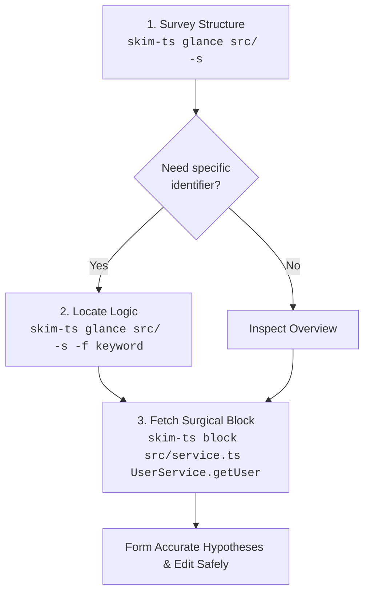

# `skim-ts`

A fast, zero-bloat, AST-based TypeScript and JavaScript outline and verbatim code block extractor tailored for AI coding agents and terminal workflows.

Conforms to the [`skim-*` Family Design Specification](../../Design.md).

---

## Why `skim-ts`?

When AI coding assistants (like Claude, Gemini, ChatGPT, or Cursor) operate on real-world codebases, feeding entire source files into prompt context is one of the quickest ways to degrade agent performance:

1. **Context Window Exhaustion & Attention Drift**: Dumping 2,000–5,000 line source files burns through token budget rapidly. More critically, irrelevant implementation details dilute the model's attention, leading to hallucinations and missed context.
2. **The Test Bloat Trap**: In modern TypeScript repositories, test files (`*.test.ts`, `*.spec.ts`, `__tests__/`) and in-file test suites (`describe()`, `it()`, `test()`) often account for 50–70% of the codebase volume. When an agent is exploring domain logic or architecture, test suites add immense noise.
3. **Repeated File Reading Loops**: Agents often read file A, find a reference to class B in file B, read all of file B, and repeat—quickly exhausting tool calls and context windows.

`skim-ts` solves this by giving agents (and developers) a pair of surgical tools:
- **`glance`**: Instant, high-density outlines of declarations, signatures, and line spans—with test code and function bodies filtered out by default.
- **`block`**: Verbatim code retrieval for an exact class, function, or qualified member (`UserService.getUser`) with line gutters or raw code ready for editing.

---

## Recommended Agent Workflow



1. **Survey (`glance -s`)**: Get the structural topography of a module or file in under 100 tokens.
2. **Locate (`glance -f <keyword>`)**: Narrow down matching declarations across files with case-insensitive substring filters.
3. **Inspect (`block <file> <target>`)**: Fetch the exact verbatim implementation block with accurate file line numbers for precision editing.

---

## Features

- **Official TypeScript Compiler API**: Uses TypeScript 6 (`ts.createSourceFile`) for 100% faithful syntactic parsing of modern syntax, JSX/TSX, decorators, generics, and ambient declarations.
- **Multi-Extension Support**: `.ts`, `.tsx`, `.js`, `.jsx`, `.mts`, `.cts`, `.mjs`, `.cjs`.
- **Test-Blind by Default**:
  - Automatically excludes `*.test.ts`, `*.spec.ts`, `*.test.tsx`, `*.spec.tsx`, and `__tests__/` directories during traversals unless `-t` / `--include-tests` is passed.
  - Detects in-file test suites (`describe()`, `it()`, `test()`, `suite()`) and filters them out of outlines and target lookups, reporting their skipped line ranges (`[tests skipped: 45..120]`).
- **Language-Idiomatic Qualified Targets**: Target methods via `Class.method`, constructors via `Class.constructor`, enum members via `Enum.member`, or standalone functions and types.
- **Exact-Case Precedence with Case-Insensitive Fallback**: Tolerates casing mismatches (`userservice.getuser`), while prioritizing exact matches if both `type Config` and `const config` coexist.
- **Clear Ambiguity Diagnostics**: If a generic target matches multiple candidates, `skim-ts` exits with code `3` and presents numbered candidate locations with disambiguation tips.
- **Instant Bundled Startup**: Bundled via Bun into a single self-contained script that starts in sub-200ms.

---

## Platform Support

- **Linux & macOS**: Supported natively (requires [Bun](https://bun.sh/) in `PATH`).
- **Windows**: Supported via **WSL2** (Windows Subsystem for Linux). Native CMD/PowerShell is not officially supported without explicitly invoking via `bun ./skim-ts`.

---

## Installation

### Linking to Local `PATH` (Linux / macOS)

Once built, symlink the executable to any directory in your `PATH` (e.g., `~/.local/bin` or `/usr/local/bin`):

```bash
mkdir -p ~/.local/bin
ln -sf "$(pwd)/skim-ts" ~/.local/bin/skim-ts
```

Ensure `~/.local/bin` is in your `PATH`, then verify the installation:

```bash
skim-ts --help
```

---

## Building from Source

### Prerequisites
- [Bun](https://bun.sh/) (v1.1+)

### Build Steps

Clone or navigate to the repository:

```bash
cd typescript/skim-ts
bun install
bun run build
```

This bundles `./src/cli.ts` into a self-contained executable script `./skim-ts` with the TypeScript compiler included.

---

## CLI Reference

```text
Usage:
  skim-ts glance [options] <path>...
  skim-ts block  [options] <file> <target>
```

### 1. `glance` Subcommand

Outlines structure, signatures, fields, and imports across files or directories.

```text
Arguments:
  <path>...                 One or more source files, directories, or globs

Options:
  -s, --signatures          Show full signatures and declarations without function bodies
  -d, --details             Show interface/type properties, enum members, and class fields
  -u, --uses, --imports     Display top-level import statements
  -f, --filter <text>       Filter items containing <text> (case-insensitive, repeatable for AND)
  -t, --include-tests       Include test files (*.test.ts, etc.) and test blocks
```

#### Examples

**Basic outline of a file:**
```bash
skim-ts glance src/service.ts
```
```text
=== src/service.ts (145 lines) ===

Outline:
  L12-L18      interface UserConfig
  L20-L45      class UserService
  L25-L30        method constructor
  L32-L44        method getUser
  L48-L60      function createRouter
```

**Signatures and imports without bodies:**
```bash
skim-ts glance src/service.ts -s -u
```
```text
=== src/service.ts (145 lines) ===

Imports:
  import { Request, Response } from "express";
  import { Database } from "./db";

Outline:
  L12-L18      export interface UserConfig<T>
  L20-L45      export class UserService<T extends Entity> extends BaseService
  L25-L30        method constructor(db: Database)
  L32-L44        method public async getUser(id: string): Promise<User>
  L48-L60      export function createRouter(): Router
```

**Include type details and field declarations (`-d`):**
```bash
skim-ts glance src/service.ts -s -d
```
```text
=== src/service.ts (145 lines) ===

Outline:
  L12-L18      export interface UserConfig<T>
                 | id: string;
                 | options: T;
                 | validate(input: string): boolean;
  L20-L45      export class UserService<T extends Entity> extends BaseService
                 | private db: Database;
                 | static instanceCount = 0;
  L25-L30        method constructor(db: Database)
  L32-L44        method public async getUser(id: string): Promise<User>
```

**Search and filter across a directory:**
```bash
skim-ts glance src/ -s -f "User" -f "auth"
```

---

### 2. `block` Subcommand

Extracts the verbatim code block for a specific class, method, function, type, or enum.

```text
Arguments:
  <file>                    Path to the source file
  <target>                  Target name (e.g. `UserService`, `UserService.getUser`, `Status.Active`)

Options:
  -t, --include-tests       Allow searching inside test files and test suites
  --raw                     Omit line number gutter and file header
```

#### Examples

**Extract with line number gutter (default):**
```bash
skim-ts block src/service.ts UserService.getUser
```
```text
=== src/service.ts (L32-L44) ===
   32 |   public async getUser(id: string): Promise<User> {
   33 |     const user = await this.db.find(id);
   34 |     if (!user) {
   35 |       throw new NotFoundError();
   36 |     }
   37 |     return user;
   38 |   }
```

**Extract raw snippet (for direct piping or code replacement):**
```bash
skim-ts block src/service.ts UserService.getUser --raw
```
```typescript
  public async getUser(id: string): Promise<User> {
    const user = await this.db.find(id);
    if (!user) {
      throw new NotFoundError();
    }
    return user;
  }
```

**Ambiguity Disambiguation:**
If a target matches more than one declaration in a file, `skim-ts` reports the conflict and offers guidance:

```bash
skim-ts block src/service.ts getUser
```
```text
Error: ambiguous target 'getUser' matched 2 candidates in src/service.ts:
  1) L32-L44    method UserService.getUser
  2) L75-L82    method AdminService.getUser

Tip: Disambiguate with Class.method (e.g. UserService.getUser) or read line range directly.
```

---

## Automated Tests

Unit tests and edge-case fixtures are located in [`fixtures/`](fixtures/) and [`tests/`](tests/).

Run test suite via Bun:
```bash
bun test
```

---

## License

MIT
