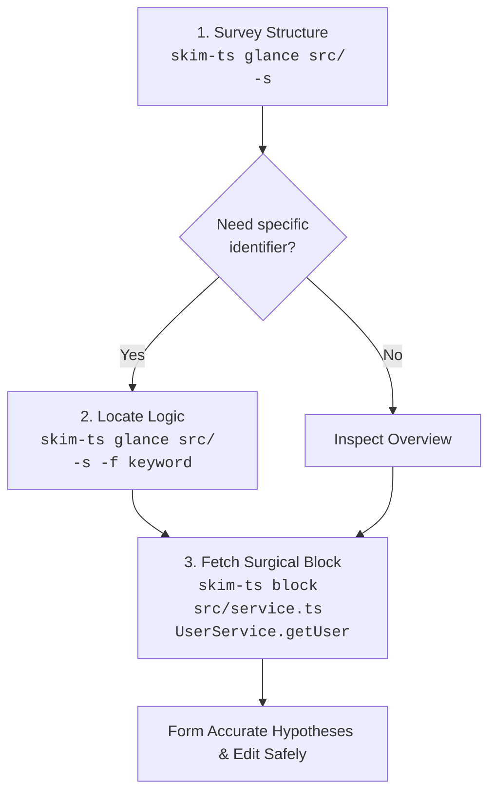

# `skim-ts`

[](https://www.npmjs.com/package/skim-ts)
[](../../LICENSE)

A fast, zero-bloat, AST-resilient TypeScript and JavaScript outline and verbatim code block extractor tailored for AI coding agents and terminal workflows.

> Part of the [`skim-*` family - check out the complete suite](https://github.com/benedictjohannes/programming-helper-utils). Conforms to the [`skim-*` Family Design Specification](https://github.com/benedictjohannes/programming-helper-utils/blob/master/Design.Skim.md).

---

## Why `skim-ts`?

When AI coding assistants (such as Claude, Gemini, ChatGPT, or Cursor) operate on real-world TypeScript/JavaScript repositories, reading entire source files into prompt context leads to performance and cost degradation:

1. **Context Window Exhaustion & Attention Drift**: Dumping 1,000–5,000 line source files burns through token budgets rapidly. More critically, irrelevant implementation details dilute the model's attention, leading to hallucinations and missed context.
2. **The Test Bloat Trap**: In modern TypeScript repositories, test files (`*.test.ts`, `*.spec.ts`, `__tests__/`) and in-file test suites (`describe()`, `it()`, `test()`) often account for 50–70% of a repository's volume. When an agent is exploring domain logic or architecture, test suites add immense noise.
3. **Repeated File Reading Loops**: Agents often read file A, find a call to a method on class B in file B, read all of file B, and repeat—quickly exhausting tool calls and context windows.
4. **Syntax Tolerance During Edits**: Codebases being actively refactored or edited often contain temporary syntax errors. Traditional strict parsers fail completely, leaving the agent unable to inspect surrounding structures.

`skim-ts` solves this by giving agents (and developers) a pair of surgical tools powered by the official TypeScript Compiler API:
- **`glance`**: Instant, high-density outlines of declarations, signatures, interface/type properties, and line spans—with test files and in-file test suites filtered out by default.
- **`block`**: Verbatim code retrieval for an exact class, function, or qualified member (`Class.method` / `ParseStatus.dirty`) with line gutters or raw code ready for editing.

---

## Recommended Agent Workflow



1. **Survey (`glance -s`)**: Get the structural topography of a package or module in under 100 tokens.
2. **Locate (`glance -f <keyword>`)**: Narrow down matching declarations across files with case-insensitive substring filters.
3. **Inspect (`block <file> <target>`)**: Fetch the exact verbatim implementation block with accurate file line numbers for precision editing.

---

## Features

- **Official TypeScript Compiler API**: Uses TypeScript 6 (`ts.createSourceFile`) for faithful syntactic parsing of modern syntax, JSX/TSX, decorators, generics, namespaces, and ambient declarations.
- **Error-Resilient Parsing**: Parses incomplete or syntactically invalid code gracefully, displaying in-flight syntax notices without crashing or skipping surrounding valid declarations.
- **Multi-Extension Support**: `.ts`, `.tsx`, `.js`, `.jsx`, `.mts`, `.cts`, `.mjs`, `.cjs`.
- **Test-Blind by Default**:
  - Automatically excludes `*.test.ts`, `*.spec.ts`, `*.test.tsx`, `*.spec.tsx`, and `__tests__/` directories during traversals unless `-t` / `--include-tests` is specified.
  - Automatically detects in-file test suites (`describe()`, `it()`, `test()`, `suite()`) and filters them out of outlines and target lookups, reporting skipped line ranges (`[tests skipped: 5..13, 15..17]`).
- **Language-Idiomatic Qualified Targets**: Target methods via `Class.method`, constructors via `Class.constructor`, enum members via `Enum.member`, or standalone functions and types.
- **Exact-Case Precedence with Case-Insensitive Fallback**: Matches `parsestatus.dirty` to `ParseStatus.dirty` while prioritizing exact case if both `type Config` and `const config` coexist.
- **Clear Ambiguity Diagnostics**: If a target matches multiple candidates, `skim-ts` exits with code `3` and presents numbered candidate locations with line spans and disambiguation tips.
- **Instant Bundled Startup**: Bundled via Bun into a single self-contained executable script that launches in sub-200ms.

---

## Installation & Usage

### On-Demand (`bunx` or `npx`)
Run directly without installing:

```bash
bunx skim-ts glance src/ -s
npx skim-ts block src/types.ts Target
```

### Global Install (`bun` / `npm`)
Install globally to add `skim-ts` directly to your `PATH` (on Linux, macOS, or Windows):

```bash
# Via Bun (Recommended)
bun add -g skim-ts

# Via NPM
npm install -g skim-ts
```

### From Local Source
```bash
git clone https://github.com/benedictjohannes/programming-helper-utils.git
cd programming-helper-utils/typescript/skim-ts
bun install
bun run build

# Link to PATH (Linux / macOS)
mkdir -p ~/.local/bin
ln -sf "$(pwd)/skim-ts" ~/.local/bin/skim-ts
```

---

## CLI Reference & Concrete Examples

> [!NOTE]
> Examples below are authentic outputs produced by running `skim-ts` against the [`colinhacks/zod`](https://github.com/colinhacks/zod) repository and local fixtures.

```text
Usage:
  skim-ts glance [options] <path>...
  skim-ts block  [options] <file> <target>
```

---

### 1. `glance` Subcommand

Outlines structure, signatures, fields, and imports across files or directories.

```text
Usage:
  skim-ts glance [options] <path>...

Arguments:
  <path>...                 One or more source files, directories, or globs

Options:
  -s, --signatures          Show full signatures and declarations without function bodies
  -d, --details             Show interface/type properties, enum members, and class fields
  -u, --uses, --imports     Display top-level import statements
  -f, --filter <text>       Filter items containing <text> (case-insensitive, repeatable for AND)
  -t, --include-tests       Include test files (*.test.ts, etc.) and test blocks
```

#### Example 1: Basic Structural Outline of a File

```bash
skim-ts glance packages/zod/src/v3/helpers/errorUtil.ts
```
```text
=== packages/zod/src/v3/helpers/errorUtil.ts (9 lines) ===

Outline:
  L2-L2        type ErrMessage
  L3-L4        function errToObj
  L6-L7        function toString
  L1-L8        namespace errorUtil
```

#### Example 2: Signatures and Imports (`-s -u`)

```bash
skim-ts glance packages/zod/src/v3/helpers/errorUtil.ts -s -u
```
```text
=== packages/zod/src/v3/helpers/errorUtil.ts (9 lines) ===

Imports: (none)

Outline:
  L2-L2        export type ErrMessage
  L3-L4        export const errToObj = (message?: ErrMessage): { message?: string | undefined } =>
  L6-L7        export const toString = (message?: ErrMessage): string | undefined =>
  L1-L8        export namespace errorUtil
```

#### Example 3: Expand Details and Class/Interface Fields (`-s -d`)

```bash
skim-ts glance packages/zod/src/v3/helpers/parseUtil.ts -s -d
```
```text
=== packages/zod/src/v3/helpers/parseUtil.ts (177 lines) ===

Outline:
  L6-L41       export const makeIssue = (params: { data: any; path: (string | number)[]; errorMaps: ZodErrorMap[]; issueData: IssueData; }): ZodIssue =>
  L43-L47      export type ParseParams
                 | path: (string | number)[];
                 | errorMap: ZodErrorMap;
                 | async: boolean;
  L49-L49      export type ParsePathComponent = string | number
  L50-L50      export type ParsePath = ParsePathComponent[]
  L51-L51      export const EMPTY_PATH: ParsePath
  L53-L64      export interface ParseContext
                 | readonly common: { readonly issues: ZodIssue[]; readonly contextualErrorMap?: ZodErrorMap | undefined; readonly async: boolean; };
                 | readonly path: ParsePath;
                 | readonly schemaErrorMap?: ZodErrorMap | undefined;
                 | readonly parent: ParseContext | null;
                 | readonly data: any;
                 | readonly parsedType: ZodParsedType;
  L66-L70      export type ParseInput
                 | data: any;
                 | path: (string | number)[];
                 | parent: ParseContext;
  L72-L86      export function addIssueToContext(ctx: ParseContext, issueData: IssueData): void
  L88-L91      export type ObjectPair
                 | key: SyncParseReturnType<any>;
                 | value: SyncParseReturnType<any>;
  L92-L151     export class ParseStatus
                 | value: "aborted" | "dirty" | "valid" = "valid";
  L94-L96        method dirty(): void
  L97-L99        method abort(): void
  L101-L110      method static mergeArray(status: ParseStatus, results: SyncParseReturnType<any>[]): SyncParseReturnType
  L112-L126      method static async mergeObjectAsync( status: ParseStatus, pairs: { key: ParseReturnType<any>; value: ParseReturnType<any> }[] ): Promise<SyncParseReturnType<any>>
  L128-L150      method static mergeObjectSync( status: ParseStatus, pairs: { key: SyncParseReturnType<any>; value: SyncParseReturnType<any>; alwaysSet?: boolean; }[] ): SyncParseReturnType
  L152-L155    export interface ParseResult
                 | status: "aborted" | "dirty" | "valid";
```

#### Example 4: Filter by Keyword across Declarations (`-f <keyword>`)

```bash
skim-ts glance packages/zod/src/v3/helpers/parseUtil.ts -s -f "makeIssue"
```
```text
=== packages/zod/src/v3/helpers/parseUtil.ts (177 lines) ===

Outline:
  L6-L41       export const makeIssue = (params: { data: any; path: (string | number)[]; errorMaps: ZodErrorMap[]; issueData: IssueData; }): ZodIssue =>
  L72-L86      export function addIssueToContext(ctx: ParseContext, issueData: IssueData): void
```

#### Example 5: In-File Test Filtering & Inclusion (`-t`)

In-file test suites (`describe()`, `it()`, `test()`) are filtered out by default, with skipped ranges highlighted:

```bash
# Default: in-file tests omitted
skim-ts glance fixtures/tests.ts
```
```text
=== fixtures/tests.ts (22 lines) [tests skipped: 5..13, 15..17] ===

Outline:
  L1-L3        function calculateTotal
  L19-L21      function helper
```

When test inspection is desired, pass `-t`:

```bash
skim-ts glance fixtures/tests.ts -t
```
```text
=== fixtures/tests.ts (22 lines) ===

Outline:
  L1-L3        function calculateTotal
  L5-L13       test describe("calculateTotal suite")
  L6-L8          test it("should sum empty list to 0")
  L10-L12        test it("should sum multiple items")
  L15-L17      test test("standalone sanity check")
  L19-L21      function helper
```

Similarly, test files (`*.test.ts`, `*.spec.ts`) are excluded by default during directory traversals and only included when `-t` is passed:

```bash
skim-ts glance packages/zod/src/v3/tests/all-errors.test.ts -t
```
```text
=== packages/zod/src/v3/tests/all-errors.test.ts (158 lines) [test] ===

Outline:
  L7-L12       const Test
  L13-L13      type TestFlattenedErrors
  L14-L14      type TestFormErrors
  L16-L24      test test("default flattened errors type inference")
  L26-L38      test test("custom flattened errors type inference")
  L40-L47      test test("form errors type inference")
  L49-L62      test test(".flatten() type assertion")
  L64-L71      test test(".formErrors type assertion")
  L73-L157     test test("all errors")
```

#### Example 6: Syntax Error Tolerance & Reporting

If a file has a syntax error during active editing or refactoring, `skim-ts` will not crash; it pinpoints syntax errors directly under the file header while outlining valid declarations:

```bash
skim-ts glance fixtures/broken.ts -s
```
```text
=== fixtures/broken.ts (13 lines) [! 1 syntax error] ===
  Syntax Notice: L7: Expression expected.

Outline:
  L1-L3        export interface WorkingConfig
  L5-L8        export function brokenFunction()
  L10-L12      export interface AnotherValidInterface
```

---

### 2. `block` Subcommand

Extracts the exact verbatim source block for a type, class, function, or `Class.method`.

```text
Usage:
  skim-ts block [options] <file> <target>

Arguments:
  <file>                    Path to the source file
  <target>                  Target identifier, e.g. Class, interface, or Class.method

Options:
  -t, --include-tests       Search inside test functions and test files
  --raw                     Omit line number gutter (clean code for edits/diffs)
```

#### Example 7: Extract Class Definition

```bash
skim-ts block packages/zod/src/v3/helpers/parseUtil.ts ParseStatus
```
```text
=== packages/zod/src/v3/helpers/parseUtil.ts (L92-L151) ===
   92 | export class ParseStatus {
   93 |   value: "aborted" | "dirty" | "valid" = "valid";
   94 |   dirty(): void {
   95 |     if (this.value === "valid") this.value = "dirty";
   96 |   }
   97 |   abort(): void {
   98 |     if (this.value !== "aborted") this.value = "aborted";
   99 |   }
  100 | 
  101 |   static mergeArray(status: ParseStatus, results: SyncParseReturnType<any>[]): SyncParseReturnType {
  102 |     const arrayValue: any[] = [];
  103 |     for (const s of results) {
  104 |       if (s.status === "aborted") return INVALID;
  105 |       if (s.status === "dirty") status.dirty();
  106 |       arrayValue.push(s.value);
  107 |     }
  108 | 
  109 |     return { status: status.value, value: arrayValue };
  110 |   }
  111 | 
  112 |   static async mergeObjectAsync(
  113 |     status: ParseStatus,
  114 |     pairs: { key: ParseReturnType<any>; value: ParseReturnType<any> }[]
  115 |   ): Promise<SyncParseReturnType<any>> {
  116 |     const syncPairs: ObjectPair[] = [];
  117 |     for (const pair of pairs) {
  118 |       const key = await pair.key;
  119 |       const value = await pair.value;
  120 |       syncPairs.push({
  121 |         key,
  122 |         value,
  123 |       });
  124 |     }
  125 |     return ParseStatus.mergeObjectSync(status, syncPairs);
  126 |   }
  127 | 
  128 |   static mergeObjectSync(
  129 |     status: ParseStatus,
  130 |     pairs: {
  131 |       key: SyncParseReturnType<any>;
  132 |       value: SyncParseReturnType<any>;
  133 |       alwaysSet?: boolean;
  134 |     }[]
  135 |   ): SyncParseReturnType {
  136 |     const finalObject: any = {};
  137 |     for (const pair of pairs) {
  138 |       const { key, value } = pair;
  139 |       if (key.status === "aborted") return INVALID;
  140 |       if (value.status === "aborted") return INVALID;
  141 |       if (key.status === "dirty") status.dirty();
  142 |       if (value.status === "dirty") status.dirty();
  143 | 
  144 |       if (key.value !== "__proto__" && (typeof value.value !== "undefined" || pair.alwaysSet)) {
  145 |         finalObject[key.value] = value.value;
  146 |       }
  147 |     }
  148 | 
  149 |     return { status: status.value, value: finalObject };
  150 |   }
  151 | }
```

#### Example 8: Extract Qualified Method (`Class.method`)

```bash
skim-ts block packages/zod/src/v3/helpers/parseUtil.ts ParseStatus.dirty
```
```text
=== packages/zod/src/v3/helpers/parseUtil.ts (L94-L96) ===
   94 |   dirty(): void {
   95 |     if (this.value === "valid") this.value = "dirty";
   96 |   }
```

Case-insensitive target matching is also supported:

```bash
skim-ts block packages/zod/src/v3/helpers/parseUtil.ts parsestatus.dirty
```

#### Example 9: Raw Output for Seamless Patching (`--raw`)

```bash
skim-ts block packages/zod/src/v3/helpers/parseUtil.ts ParseStatus.dirty --raw
```
```typescript
  dirty(): void {
    if (this.value === "valid") this.value = "dirty";
  }
```

#### Example 10: Disambiguation Handling

When multiple candidates match an ambiguous target name, `skim-ts` exits with status `3` and provides candidates and resolution tips:

```bash
skim-ts block fixtures/ambiguous.ts parse
```
```text
Error: ambiguous target 'parse' matched 2 candidates in fixtures/ambiguous.ts:
  1) L2-L4      method UserRepo.parse
  2) L8-L10     method ConfigRepo.parse

Tip: Disambiguate with Class.method (e.g. UserService.getUser) or read line range directly.
```

#### Example 11: Syntax Notice Inside Extracted Block

If an extracted block contains a syntax error within its line span, the warning is surfaced directly above the block:

```bash
skim-ts block fixtures/broken.ts brokenFunction
```
```text
=== fixtures/broken.ts (L5-L8) [! 1 syntax error] ===
  Syntax Notice: L7: Expression expected.
    5 | export function brokenFunction() {
    6 |   const x =
    7 |   const y = 20;
    8 | }
```

---

## Exit Codes

`skim-ts` adheres to standardized POSIX / CLI exit codes:

| Code | Meaning |
|:---:|:---|
| `0` | **Success**: Operation completed normally. |
| `1` | **Error**: Path not found, I/O failure, or invalid CLI flag. |
| `2` | **Not Found**: The specified target symbol was not found in the file. |
| `3` | **Ambiguous**: Multiple candidates match the target symbol; disambiguation required. |

---

## Automated Tests

Unit tests and edge-case fixtures are located in [`fixtures/`](fixtures/) and [`tests/`](tests/).

Run test suite via Bun:
```bash
bun run check  # Type checking via tsc --noEmit
bun test       # Unit & integration tests
```

---

## License

MIT
